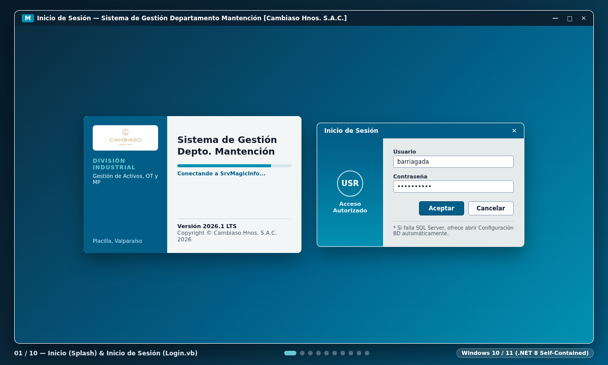
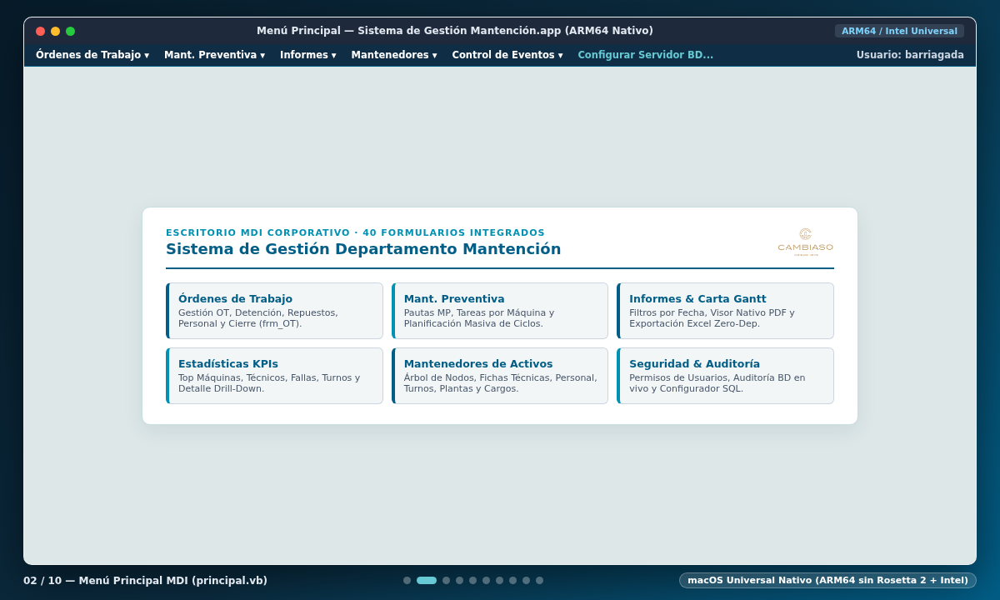
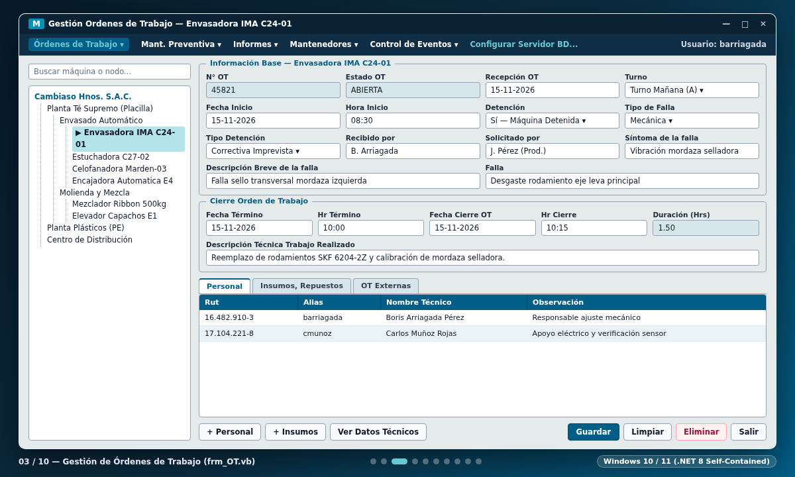
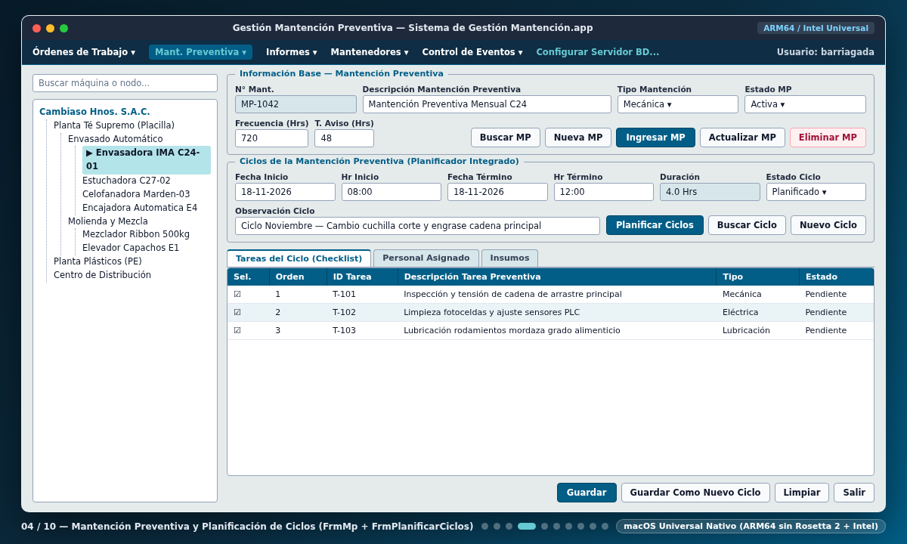
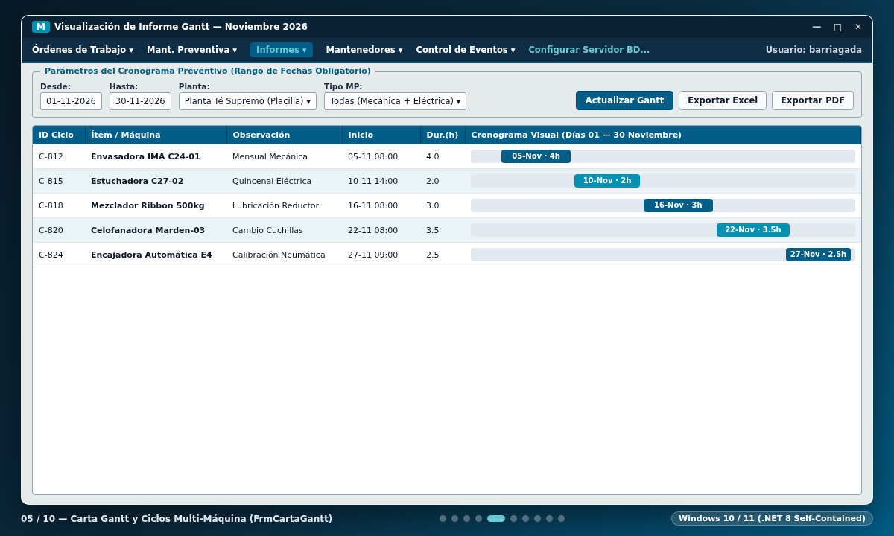
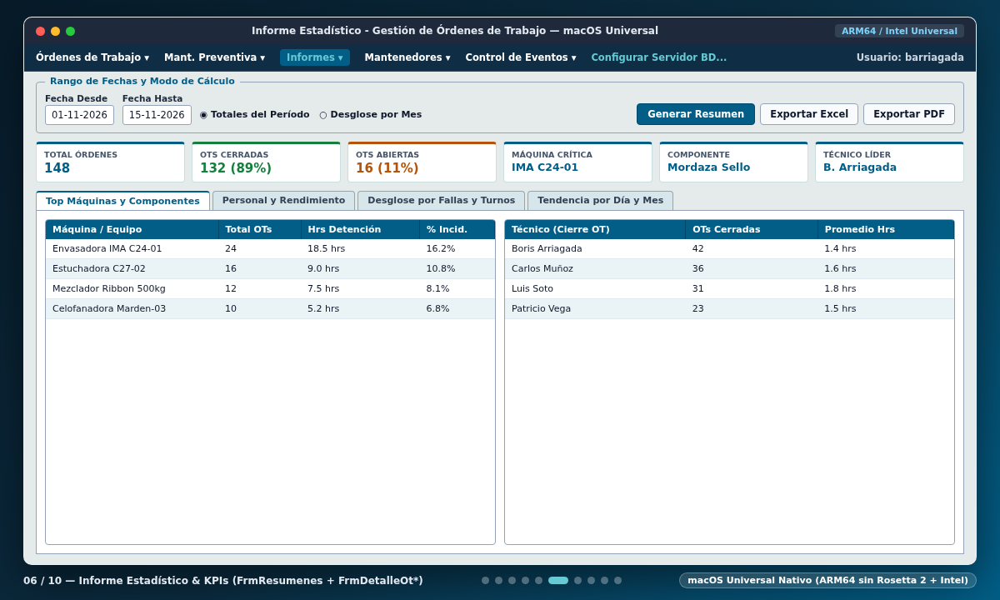
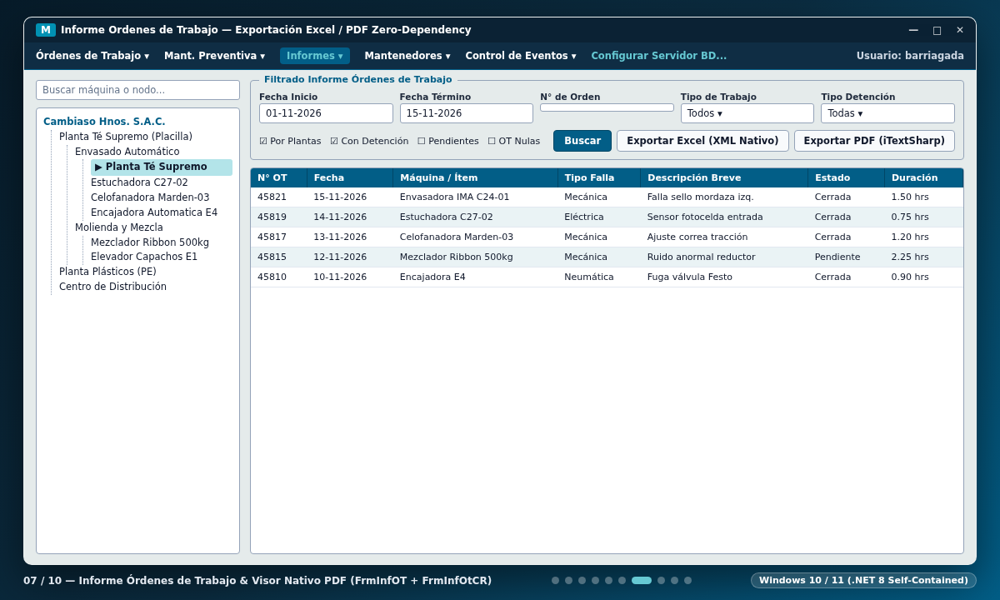
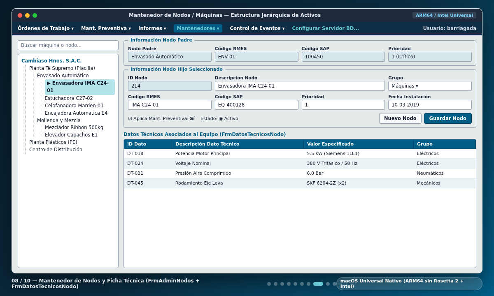
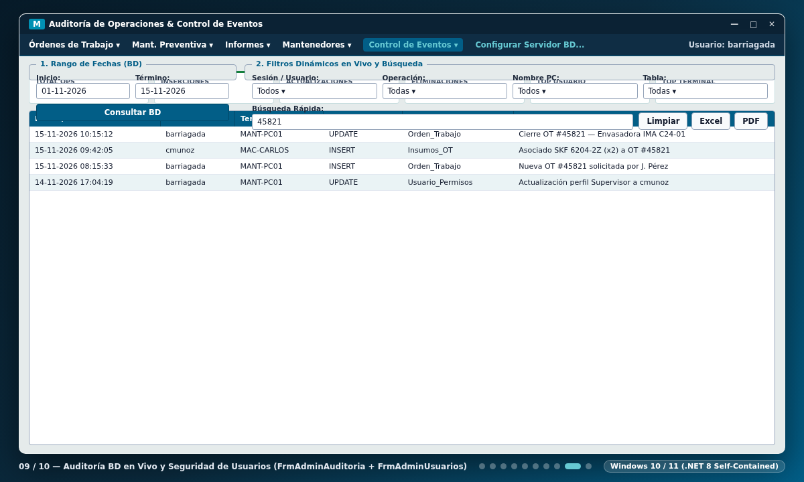
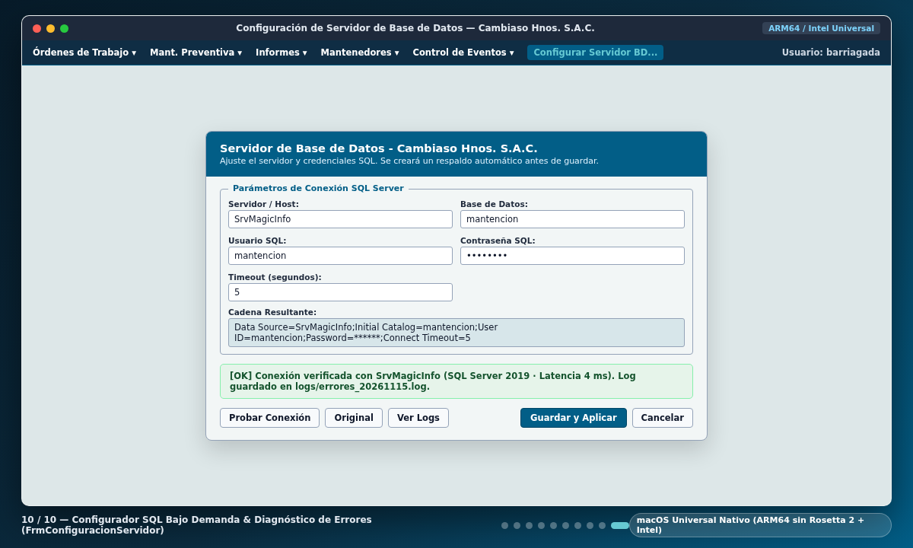

<div align="center">

<p align="center">
  
</p>

# Sistema de Gestión Departamento Mantención
### Cambiaso Hnos. S.A.C. — División de Mantención Industrial
**Plataforma Integral de Órdenes de Trabajo (OT), Mantención Preventiva (MP) y Control Técnico**

[](https://github.com/barriagada666-collab/Sistema_gestion_Mantencion/actions/workflows/build-and-package.yml)
[](https://github.com/barriagada666-collab/Sistema_gestion_Mantencion/releases)
[](https://github.com/barriagada666-collab/Sistema_gestion_Mantencion/releases)
[](https://dotnet.microsoft.com/)
[](https://www.microsoft.com/sql-server)
[](https://github.com/barriagada666-collab)

<p align="center">
  <a href="https://github.com/barriagada666-collab/Sistema_gestion_Mantencion/releases/download/v2026.1/Instalador_Sistema_Mantencion_v2026.1.exe"></a>&nbsp;
  <a href="https://github.com/barriagada666-collab/Sistema_gestion_Mantencion/releases/download/v2026.1/Instalador_Sistema_Mantencion_v2026.1_macOS.dmg"></a>
</p>

</div>

---

## 📌 Descripción del Proyecto

El **Sistema de Gestión Departamento Mantención** es una solución informática de clase industrial (CMMS / ERP de Mantenimiento) diseñada específicamente para la administración, programación, control operativo y análisis estadístico del mantenimiento mecánico y eléctrico en las plantas productivas de **Cambiaso Hnos. S.A.C.**

Permite digitalizar el ciclo de vida completo de las intervenciones técnicas en planta: desde la detección de una falla imprevista o la planificación cíclica de mantenciones preventivas, hasta el registro de repuestos, tiempos de detención, personal técnico asignado y reportabilidad ejecutiva con **filtrado universal por rango de fechas** para la toma de decisiones.

---

## 🖼️ Galería Visual (Carrusel Dinámico de Pantallas)

<p align="center">
  
</p>

<details>
<summary>📸 <strong>Ver galería completa por pantalla (10 capturas en alta resolución · Windows 11 &amp; macOS Universal)</strong></summary>

<br/>

| # | Módulo / Formulario | Vista Previa |
| :---: | :--- | :---: |
| **01** | **Inicio &amp; Login Limpio** (`Inicio`, `Login`)<br/><sub>Arranque corporativo y acceso limpio sin botones de servidor expuestos; ofrece configuración SQL solo si falla la conexión.</sub> | [](docs/screenshots/01_inicio_login.png) |
| **02** | **Menú Principal MDI** (`principal`)<br/><sub>Barra corporativa `#0F2D44` con control granular de permisos por perfil y accesos rápidos en macOS / Windows.</sub> | [](docs/screenshots/02_menu_principal.png) |
| **03** | **Gestión de Órdenes de Trabajo** (`frm_OT`)<br/><sub>Árbol jerárquico de plantas/equipos, registro de fallas, tiempos de detención, personal, insumos y cierre.</sub> | [](docs/screenshots/03_gestion_ot.png) |
| **04** | **Mantención Preventiva &amp; Ciclos** (`FrmMp`, `FrmPlanificarCiclos`)<br/><sub>Pautas por frecuencia horaria, planificación masiva de ciclos, checklists mecánicos/eléctricos e insumos.</sub> | [](docs/screenshots/04_mant_preventiva.png) |
| **05** | **Carta Gantt Preventiva** (`FrmCartaGantt`, `FrmInfMantPrevCiclosMaq`)<br/><sub>Visualización temporal multi-máquina con rango obligatorio de fechas y exportación directa a Excel y PDF.</sub> | [](docs/screenshots/05_carta_gantt.png) |
| **06** | **Estadísticas &amp; KPIs** (`FrmResumenes`, `FrmDetalleOt*`)<br/><sub>6 tarjetas KPI en vivo, rankings por máquina, técnico, tipo de falla y turno con detalle drill-down.</sub> | [](docs/screenshots/06_estadisticas_kpi.png) |
| **07** | **Informes OT &amp; Visor Nativo** (`FrmInfOT`, `FrmInfOtCR`)<br/><sub>Exportación autónoma a Excel (SpreadsheetML) y PDF vectorial (iTextSharp) sin Crystal Reports ni Office.</sub> | [](docs/screenshots/07_informes_visor.png) |
| **08** | **Activos, Nodos &amp; Fichas Técnicas** (`FrmAdminNodos`, `FrmDatosTecnicosNodo`)<br/><sub>Árbol Empresa → Planta → Sección → Máquina → Módulo con códigos SAP, RMES y atributos técnicos.</sub> | [](docs/screenshots/08_nodos_tecnicos.png) |
| **09** | **Auditoría BD &amp; Seguridad** (`FrmAdminAuditoria`, `FrmAdminUsuarios`)<br/><sub>Trazabilidad completa de operaciones SQL con filtros en vivo, KPIs, perfiles y matriz de permisos.</sub> | [](docs/screenshots/09_auditoria_usuarios.png) |
| **10** | **Configurador SQL &amp; Logs** (`FrmConfiguracionServidor`, `RegistroErrores`)<br/><sub>Asistente bajo demanda con prueba de conexión, respaldo automático de `App.config` y registro de errores.</sub> | [](docs/screenshots/10_configurador_sql.png) |

</details>

---

## ⚙️ ¿Qué hace el Sistema? (Módulos Principales)

### 📋 1. Gestión de Órdenes de Trabajo (OT)
* **Registro y Emisión:** Apertura ágil de órdenes correctivas y programadas asociadas a plantas, secciones y máquinas.
* **Control Operativo:** Tipificación de fallas (mecánicas, eléctricas, operacionales), causas raíz y síntomas detectados.
* **Tiempos y Dotación:** Registro exacto de horas de detención de maquinaria, técnicos asignados y horas-hombre invertidas.
* **Insumos y Repuestos:** Detalle de repuestos utilizados con control de costos y proveedores.

### 🛠️ 2. Mantención Preventiva (MP) y Planificación Cíclica
* **Pautas Preventivas:** Configuración de rutinas preventivas por frecuencia en días o por horas acumuladas de operación.
* **Listas de Chequeo Dinámicas:** Checklists diferenciados para tareas mecánicas y eléctricas con tiempos estándar.
* **Carta Gantt Interactiva:** Visualización gráfica temporal de las intervenciones preventivas programadas por línea, equipo y rango de fechas, con exportación directa a Excel y PDF.
* **Planificador de Ciclos:** Despliegue de ciclos futuros con reprogramación automática.

### 🏭 3. Estructura Jerárquica de Activos (Nodos de Planta)
* **Árbol de Equipos:** Navegación arbórea multinivel estructurada en `Empresa > Planta > Sección > Máquina > Módulo > Componente`.
* **Fichas Técnicas:** Catálogo de especificaciones técnicas (potencias, rodamientos, voltajes, presiones y manuales asociados).

### 👥 4. Dotación de Personal y Calendario de Turnos
* **Ficha del Personal:** Administración de técnicos mecánicos, electricistas y supervisores con sus especialidades.
* **Programación de Turnos:** Generación dinámica de calendarios de turnos rotativos para control de dotación disponible en planta.

### 📊 5. Estadísticas, Informes y Exportación (Cero Dependencias)
* **Filtro Obligatorio por Rango de Fechas (`Desde` / `Hasta`):** Todos los módulos de informes (`Informe OT`, `Mantención Preventiva`, `Ciclos por Máquina`, `Carta Gantt`, `Resúmenes Estadísticos` y `Auditoría`) mantienen siempre activos y validados (`Desde <= Hasta`) los selectores de fecha con inicialización automática del mes en curso.
* **Tableros de Control:** Resúmenes estadísticos interactivos de OTs por técnico, por tipo de falla, por turno y por día.
* **Exportación Dual a Excel (COM + Respaldo Nativo):** Usa plantillas institucionales `.xls` cuando Microsoft Excel está instalado, e incluye un **motor nativo XML SpreadsheetML** para exportar sin depender de Office/Excel en Windows o macOS.
* **Exportación Autónoma a PDF (iTextSharp):** Generación vectorial directa a PDF en todos los módulos de reportes (OT, MP, Ciclos, Carta Gantt, Resúmenes Estadísticos y Auditoría), sin Crystal Reports ni software de terceros.

### 🔐 6. Auditoría Integral y Seguridad
* **Trazabilidad en Tiempo Real:** Registro detallado de cada operación (altas, bajas, modificaciones) con usuario, fecha, hora, equipo (PC) y tabla afectada.
* **Matriz de Permisos:** Control de acceso granular por perfiles de usuario a cada módulo y menú del sistema.

### ⚡ 7. Asistente de Configuración SQL y Diagnóstico de Errores
* **Configuración Bajo Demanda y desde Menú:** La pantalla **Inicio de Sesión** se mantiene limpia; si ocurre un fallo de conexión SQL, el sistema explica la causa y pregunta automáticamente si desea abrir **Configurar Servidor BD**. También puede ajustarse manualmente una vez dentro desde **Mantenedores > Configurar Servidor BD...**.
* **Mensajes Comprensibles en Español:** Captura automática de excepciones UI/dominio y fallos SQL (p. ej. error 40, red/VPN desconectada, credenciales o permisos), explicando la causa y ofreciendo abrir la configuración SQL en un clic.
* **Registro Persistente para Depuración:** Guarda automáticamente el detalle técnico completo (`errores_yyyyMMdd.log` con depuración a 30 días) en `%LOCALAPPDATA%\SistemaMantencion\logs\`, accesible desde **Mantenedores > Ver Registro de Errores (Logs)...** o desde el botón **Ver Logs**.

---

## 💻 ¿Qué se necesita para ejecutar el Sistema? (Requisitos)

### 🪟 Para Usuarios en Windows:
* **Sistema Operativo:** Windows 10 o Windows 11 (ediciones de 64 bits).
* **Dependencias:** **Ninguna (Zero-Dependency).** La aplicación está publicada en modo **autocontenido y depurado** (.NET 8 Runtime integrado). No requiere instalar .NET, SQL Client, Crystal Reports ni Microsoft Office.
* **Red:** Conexión a la red local de la empresa o VPN corporativa para comunicarse con el servidor SQL Server.

### 🍏 Para Usuarios en macOS:
* **Sistema Operativo:** macOS 15 Sequoia o superior en Apple Silicon (incluyendo **macOS 27 Golden Gate** y **macOS 28+** sin Rosetta 2), y macOS 11+ en equipos Intel.
* **Hardware:** Binario **Universal Nativo (`arm64` + `x86_64`)** compatible con procesadores **Apple Silicon** (M1, M2, M3, M4 — ejecución **100% nativa ARM64 sin Rosetta 2**) y procesadores **Intel**.
* **Entorno de Ejecución:** **Autocontenido (Cero Dependencias)**. Incluye motor nativo ARM64 (`MetalSharp-Wine v7.0` + `.NET 8 win-arm64`) para Apple Silicon sin alertas de apps Intel, y motor Wine Staging 11.21 + `.NET 8 win-x64` para Macs Intel.
* **Instalación:** Se incluye imagen `.dmg` (compresión LZMA) y paquete `.zip` con instalador automático en un clic (`Instalar_en_Mac.command`), que deja en `/Applications` únicamente el motor nativo de su procesador y crea acceso directo en el Escritorio.

### 🗄️ Para el Servidor de Base de Datos:
* **Motor:** Microsoft SQL Server 2008, 2012, 2014, 2016, 2019, 2022 o Azure SQL Database.
* **Base de Datos:** Instancia con la base de datos `mantencion`.
* **Configuración por defecto:**
  * Host / Servidor: `SrvMagicInfo` (o la IP/nombre configurada en tu red).
  * Catálogo: `mantencion`
  * Usuario: `mantencion`
  * Autenticación: SQL Server Authentication o Windows Integrated Security.

### 🛠️ Para Desarrolladores y Compilación:
* **SDK:** Microsoft .NET 8.0 SDK (`8.0.x` o superior).
* **IDE Recomendado:** Visual Studio 2022 (con carga de trabajo *.NET Desktop Development*) o Visual Studio Code en Linux/macOS.
* **Compilación por consola:**
  ```bash
  dotnet build mantencion.sln -c Release
  ```

---

## 📦 Descargas Oficiales (v2026.1 LTS)

> **Nota:** Todos los instaladores son **autocontenidos, compactados y libres de dependencias externas**.

| Plataforma | Formato | Tamaño | Enlace Directo |
| :--- | :---: | :---: | :--- |
| 🪟 **Windows 10 / 11** (64-bit) | `.exe` | `41.37 MB` | [⬇️ **Descargar Instalador Windows**](https://github.com/barriagada666-collab/Sistema_gestion_Mantencion/releases/download/v2026.1/Instalador_Sistema_Mantencion_v2026.1.exe) |
| 🍏 **macOS Universal Nativo** (M1–M4 sin Rosetta / Intel) | `.dmg` | `272.56 MB` | [⬇️ **Descargar Imagen DMG para Mac**](https://github.com/barriagada666-collab/Sistema_gestion_Mantencion/releases/download/v2026.1/Instalador_Sistema_Mantencion_v2026.1_macOS.dmg) |
| 🍏 **macOS Universal Nativo** (M1–M4 sin Rosetta / Intel) | `.zip` | `344.73 MB` | [⬇️ **Descargar Paquete ZIP para Mac**](https://github.com/barriagada666-collab/Sistema_gestion_Mantencion/releases/download/v2026.1/Instalador_Sistema_Mantencion_v2026.1_macOS_Universal.zip) |
| 📦 **GitHub Packages** | `.nupkg` | `2.00 MB` | [⬇️ **Descargar Paquete NuGet**](https://github.com/barriagada666-collab/Sistema_gestion_Mantencion/releases/download/v2026.1/Sistema.Gestion.Mantencion.2026.1.0.nupkg) |

<details>
<summary>🔐 Verificación de Integridad (SHA-256 oficial en <code>/Instalador</code>)</summary>

| Archivo | SHA-256 |
| :--- | :--- |
| `Instalador_Sistema_Mantencion_v2026.1.exe` | `7B7922C9146E21F76C6A2B5817C4625FABECD1272D6C41685EC3F29A8DBE3038` |
| `Instalador_Sistema_Mantencion_v2026.1_macOS.dmg` | `2db92af8da5a5e44d4e7ec93fedff8ee1c5d18f8c0b2250bae08b0a2cf691b84` |
| `Instalador_Sistema_Mantencion_v2026.1_macOS_Universal.zip` | `37204c125cb02d59c8d62ea807111d45f529c42dc2ec86bebfebedfb5b488657` |
| `Sistema.Gestion.Mantencion.2026.1.0.nupkg` | `a2d6958358f29cc15164d2116328cd9d933b0d8ac2e75c93139cdf1d33248c7d` |

</details>

> 📁 *Todos los archivos binarios de instalación y sus checksums SHA-256 (`checksums_sha256.txt` y `checksums_mac_sha256.txt`) se sincronizan automáticamente en la carpeta [`/Instalador`](https://github.com/barriagada666-collab/Sistema_gestion_Mantencion/tree/main/Instalador) del repositorio en cada compilación.*

---

## 🚀 Guía de Instalación Rápida

### En Windows:
1. Descargue el archivo `Instalador_Sistema_Mantencion_v2026.1.exe`.
2. Ejecute el instalador y siga el asistente estándar.
3. La aplicación creará automáticamente accesos directos en el **Escritorio** y en el **Menú Inicio**.

### En Mac (macOS):
1. Descargue `Instalador_Sistema_Mantencion_v2026.1_macOS.dmg` (o el paquete `.zip`).
2. **Instalación recomendada:** Haga doble clic en `Instalar_en_Mac.command` para instalar en `/Applications`, conservar únicamente el motor nativo de su procesador (Apple Silicon ARM64 o Intel), quitar restricciones de Gatekeeper y crear acceso directo en el Escritorio.
3. También puede arrastrar la aplicación directamente a **Aplicaciones** (ejecuta como **Aplicación Universal** nativa sin Rosetta 2 en Apple Silicon M1–M4 y es compatible con macOS 27 Golden Gate y 28+).

### Conexión a Base de Datos en el Primer Inicio:
1. Al iniciar sesión, si ocurre un fallo de conexión o el servidor SQL de su empresa usa otro nombre o IP distinto a `SrvMagicInfo` (frecuente fuera de la red LAN corporativa o en macOS), el sistema explicará la causa y le ofrecerá abrir automáticamente **Configurar Servidor BD**. Una vez dentro del sistema también puede acceder desde **Mantenedores > Configurar Servidor BD...**.
2. Ingrese el Host/IP, Base de Datos y Credenciales.
3. Presione **Probar Conexión** y luego **Guardar y Aplicar**.

---

## 📦 Paquete de Desarrollo (GitHub Packages / NuGet)

Para consumir la biblioteca y componentes del sistema en otros proyectos .NET:

```bash
dotnet add package Sistema.Gestion.Mantencion --version 2026.1.0
```

*Registro oficial:* [GitHub Packages - Sistema.Gestion.Mantencion](https://github.com/users/barriagada666-collab/packages/nuget/package/Sistema.Gestion.Mantencion)

---

## 🌟 Novedades de la Versión 2026.1 LTS

* **🎨 Identidad Visual Corporativa Unificada (`Segoe UI`):** Paleta corporativa oficial (`#025E87`, `#0191B3`, `#66C9D3`, `#E5EBEB`, `#F2F6F6`, `#0F2D44`), renderizador moderno de menús/barras, ajuste automático a pantalla, selectores de fecha ampliados (`106x23`) y botones corregidos en `Inicio de Sesión`.
* **🛡️ Captura Global y Diagnóstico Claro de Errores:** Todos los errores de red SQL Server, consultas y UI se traducen a explicaciones claras en español, ofrecen abrir **Configurar Servidor BD** en un clic y se guardan en `%LOCALAPPDATA%\SistemaMantencion\logs\errores_yyyyMMdd.log` para depuración.
* **📅 Filtrado Obligatorio por Rango de Fechas en Todos los Informes:** Selección `Desde` / `Hasta` siempre visible, habilitada y validada en OT, Mantención Preventiva, Ciclos por Máquina, Carta Gantt, Resúmenes Estadísticos y Auditoría.
* **📑 Exportación Excel y PDF Sin Dependencias:** Motor nativo SpreadsheetML (`.xls`) y motor vectorial iTextSharp (`.pdf`) integrados en todos los informes cuando Microsoft Excel no está presente.
* **⚡ Transiciones MDI y Consultas Optimizadas:** `DoubleBuffered`, `SuspendLayout`/`ResumeLayout`, caché de catálogos, precalentamiento de pool SQL y búsquedas `O(1)` en generación de Carta Gantt.
* **📦 Instaladores Ultra-Compactos:** Depuración automática de ensamblados WPF no utilizados, símbolos de depuración, duplicados de plantillas y satélites de idiomas extranjeros; compresión LZMA2 (`Windows`) y ULMO LZMA (`macOS`).
* **🍏 Soporte Nativo Universal para macOS (Sin Rosetta 2):** Binario Mach-O Universal (`arm64` + `x86_64`) con entorno UTF-8 forzado desde el launcher nativo, ejecución 100% nativa en Apple Silicon (M1–M4), eliminando avisos de apps Intel en macOS 27 Golden Gate y garantizando compatibilidad futura con macOS 28+.
* **🛡️ Cero Advertencias y Cero Errores:** Código fuente 100% verificado, sin archivos huérfanos y validado bajo estándares modernos de compilación.

---

<div align="center">

### Cambiaso Hnos. S.A.C. — División de Mantención Industrial
📍 *Virginia Bravo Letelier 777, Placilla de Peñuelas, Valparaíso, Chile*  
👨‍💻 **Desarrollado y mantenido por Boris Arriagada**

</div>
