<div align="center">

<p align="center">
  
</p>

# Sistema de Gestión Departamento Mantención
### Cambiaso Hnos. S.A.C. — División de Mantención Industrial
**Plataforma Integral de Órdenes de Trabajo (OT), Mantención Preventiva (MP) y Control Técnico**

[](https://github.com/barriagada666-collab/Sistema_gestion_Mantencion/actions/workflows/build-and-package.yml)
[](https://github.com/barriagada666-collab/Sistema_gestion_Mantencion/releases)
[](https://github.com/barriagada666-collab/Sistema_gestion_Mantencion/releases)
[](https://dotnet.microsoft.com/)
[](https://www.microsoft.com/sql-server)
[](https://github.com/barriagada666-collab)

<p align="center">
  <a href="https://github.com/barriagada666-collab/Sistema_gestion_Mantencion/releases/download/v2026.1/Instalador_Sistema_Mantencion_v2026.1.exe"></a>&nbsp;
  <a href="https://github.com/barriagada666-collab/Sistema_gestion_Mantencion/releases/download/v2026.1/Instalador_Sistema_Mantencion_v2026.1_macOS.dmg"></a>
</p>

</div>

---

## 📌 Descripción del Proyecto

El **Sistema de Gestión Departamento Mantención** es una plataforma CMMS / EAM de grado industrial desarrollada sobre **.NET 8 LTS**, diseñada específicamente para la administración, programación cíclica, control operativo, auditoría y análisis estadístico del mantenimiento mecánico y eléctrico en las plantas productivas de **Cambiaso Hnos. S.A.C.**

Digitaliza de extremo a extremo el ciclo de vida de cada intervención técnica a través de **40 formularios unificados** y **7 plantillas `.xls` institucionales** bajo una identidad visual corporativa homogénea (`#025E87`, `#0191B3`, `#66C9D3`, `#0F2D44`, `#DDE7E8`, `#F2F6F6`): desde la detección de fallas imprevistas o la planificación preventiva en Carta Gantt y carga instantánea de jerarquías de activos, hasta el control de repuestos, horas de detención, dotación técnica, gestión completa de usuarios/perfiles (`21` permisos), **filtrado obligatorio por rango de fechas (`Desde` / `Hasta`)** y exportación nativa a Excel (XML SpreadsheetML) y PDF vectorial horizontal completo (`iTextSharp`, `Landscape FitW=1`) sin dependencias de Office ni Crystal Reports en Windows 10/11 y macOS Universal (Apple Silicon ARM64 sin Rosetta 2 + Intel).

---

## 🖼️ Galería Visual (Carrusel Dinámico de los 40 Formularios)

<p align="center">
  
</p>

<details>
<summary>📸 <strong>Ver las 40 capturas individuales en alta resolución (Windows 11 &amp; macOS Universal)</strong></summary>

<br/>

| Formulario (Impar) | Formulario (Par) |
| :---: | :---: |
| **01. `Inicio`** — Splash Corporativo<br/>[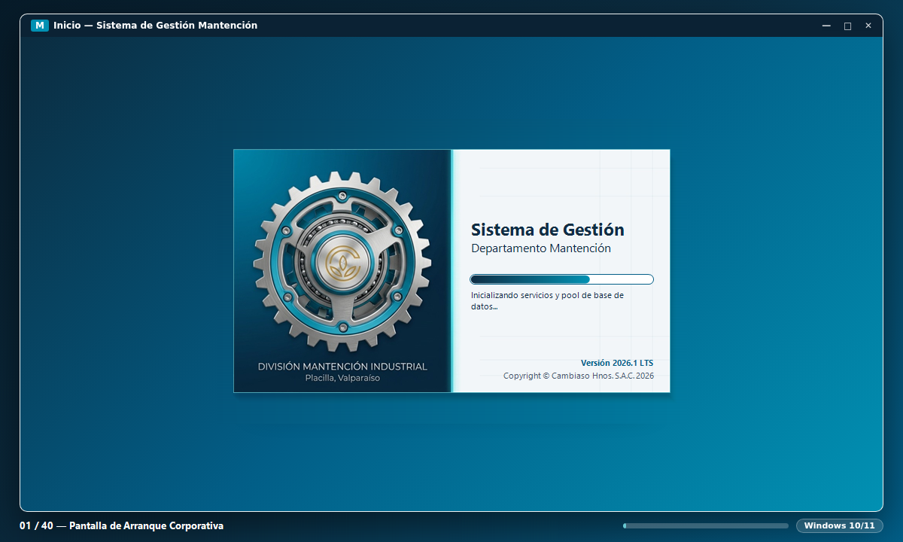](docs/screenshots/01_Inicio.png) | **02. `Login`** — Inicio de Sesión Limpio<br/>[](docs/screenshots/02_Login.png) |
| **03. `principal`** — Escritorio MDI (Logo y Título)<br/>[](docs/screenshots/03_principal.png) | **04. `FrmConfiguracionServidor`** — Asistente SQL<br/>[](docs/screenshots/04_FrmConfiguracionServidor.png) |
| **05. `frm_OT`** — Gestión Órdenes de Trabajo<br/>[](docs/screenshots/05_frm_OT.png) | **06. `FrmDetalleOt`** — Detalle Completo de OT<br/>[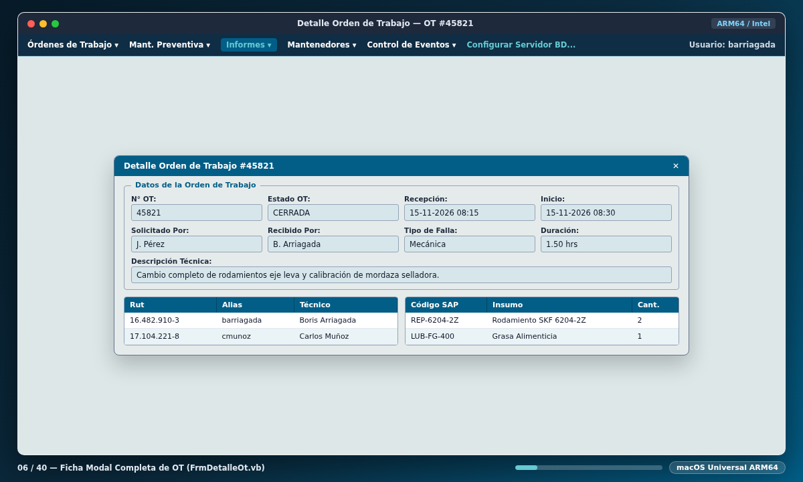](docs/screenshots/06_FrmDetalleOt.png) |
| **07. `FrmMp`** — Gestión Mantención Preventiva<br/>[](docs/screenshots/07_FrmMp.png) | **08. `FrmAdminTareasNodo`** — Tareas por Máquina<br/>[](docs/screenshots/08_FrmAdminTareasNodo.png) |
| **09. `FrmPlanificarCiclos`** — Planificador Masivo<br/>[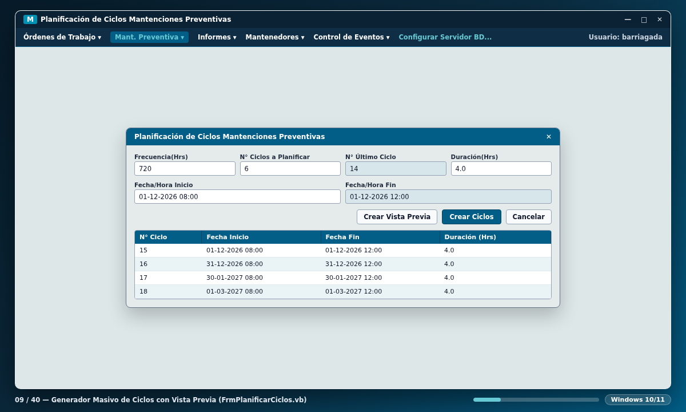](docs/screenshots/09_FrmPlanificarCiclos.png) | **10. `FrmInfOT`** — Informe Órdenes de Trabajo<br/>[](docs/screenshots/10_FrmInfOT.png) |
| **11. `FrmInfOtCR`** — Visor Nativo PDF/Impresión<br/>[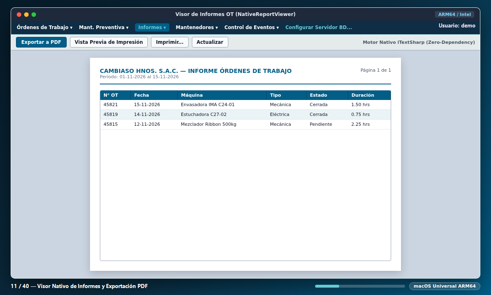](docs/screenshots/11_FrmInfOtCR.png) | **12. `FrmInfMantPrev`** — Informe MP Individual<br/>[](docs/screenshots/12_FrmInfMantPrev.png) |
| **13. `FrmInfMantPrevCiclosMaq`** — Ciclos Varias Máquinas<br/>[](docs/screenshots/13_FrmInfMantPrevCiclosMaq.png) | **14. `FrmCartaGantt`** — Carta Gantt Preventiva<br/>[](docs/screenshots/14_FrmCartaGantt.png) |
| **15. `FrmResumenes`** — Estadísticas &amp; 6 KPIs<br/>[](docs/screenshots/15_FrmResumenes.png) | **16. `FrmDetalleOTDia`** — Detalle OT Por Día<br/>[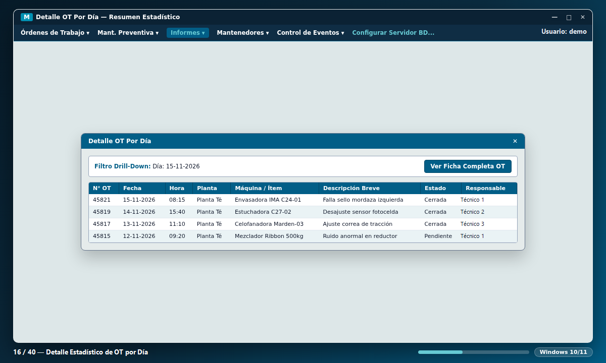](docs/screenshots/16_FrmDetalleOTDia.png) |
| **17. `FrmDetalleOTPorTecnico`** — Detalle Por Técnico<br/>[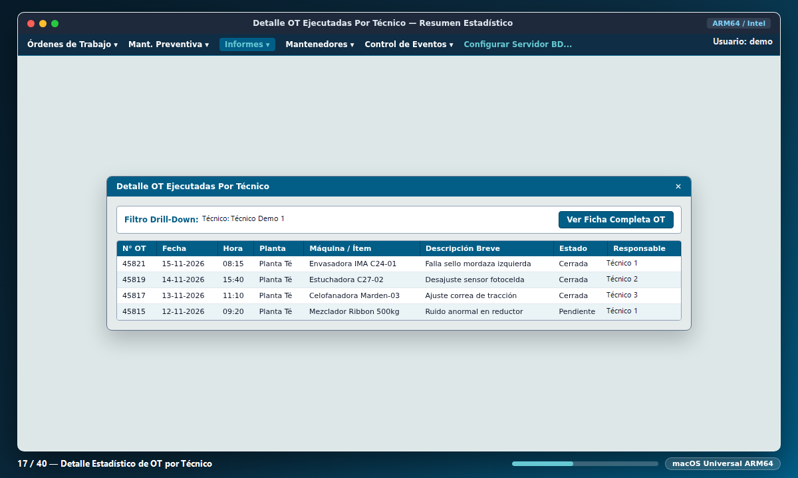](docs/screenshots/17_FrmDetalleOTPorTecnico.png) | **18. `FrmDetalleOtEstado`** — Detalle Por Estado<br/>[](docs/screenshots/18_FrmDetalleOtEstado.png) |
| **19. `FrmDetalleOtPendientes`** — Detalle Pendientes<br/>[](docs/screenshots/19_FrmDetalleOtPendientes.png) | **20. `FrmDetalleOtTipoFalla`** — Detalle Por Falla<br/>[](docs/screenshots/20_FrmDetalleOtTipoFalla.png) |
| **21. `FrmDetalleOtTurno`** — Detalle Por Turno<br/>[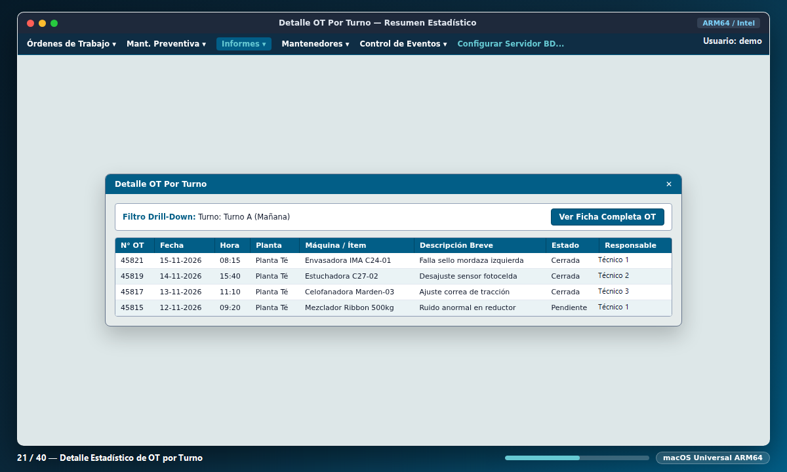](docs/screenshots/21_FrmDetalleOtTurno.png) | **22. `FrmAdminNodos`** — Mantenedor de Nodos<br/>[](docs/screenshots/22_FrmAdminNodos.png) |
| **23. `FrmDatosTecnicos`** — Catálogo Datos Técnicos<br/>[](docs/screenshots/23_FrmDatosTecnicos.png) | **24. `FrmDatosTecnicosNodo`** — Fichas por Máquina<br/>[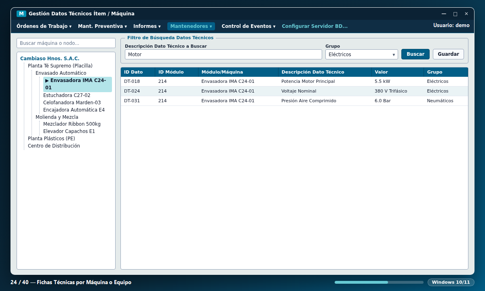](docs/screenshots/24_FrmDatosTecnicosNodo.png) |
| **25. `FrmVerDatosTecnicos`** — Modal Ficha Técnica<br/>[](docs/screenshots/25_FrmVerDatosTecnicos.png) | **26. `FrmPersonal`** — Gestión de Personal<br/>[](docs/screenshots/26_FrmPersonal.png) |
| **27. `FrmCalendarioTurno`** — Calendario de Turnos<br/>[](docs/screenshots/27_FrmCalendarioTurno.png) | **28. `FrmCargo`** — Administración de Cargos<br/>[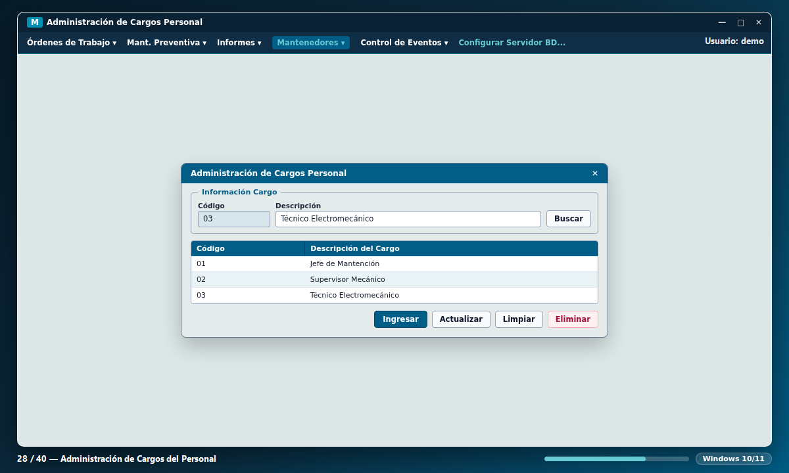](docs/screenshots/28_FrmCargo.png) |
| **29. `FrmPlantas`** — Mantenedor de Plantas<br/>[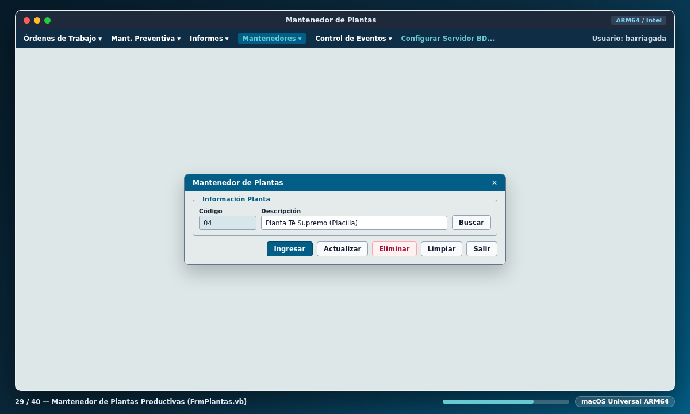](docs/screenshots/29_FrmPlantas.png) | **30. `FrmSeccion`** — Mantenedor de Secciones<br/>[](docs/screenshots/30_FrmSeccion.png) |
| **31. `FrmAdminUsuarios`** — Usuarios y Permisos<br/>[](docs/screenshots/31_FrmAdminUsuarios.png) | **32. `FrmAdminAuditoria`** — Auditoría BD y KPIs<br/>[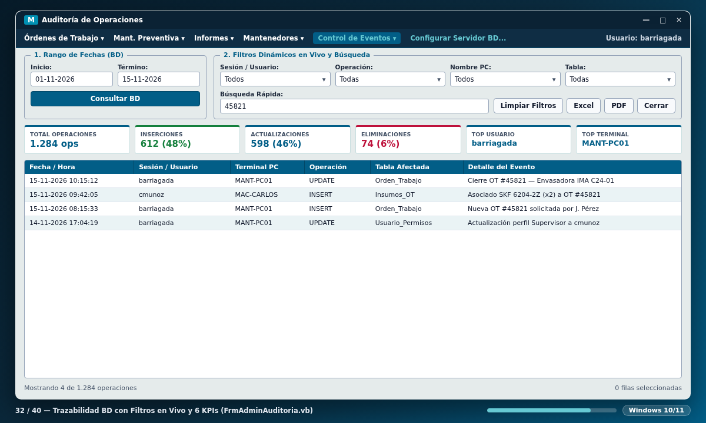](docs/screenshots/32_FrmAdminAuditoria.png) |
| **33. `FrmBuscarMp`** — Buscar Mant. Preventiva<br/>[](docs/screenshots/33_FrmBuscarMp.png) | **34. `FrmBuscarCiclo`** — Buscar Ciclos MP<br/>[](docs/screenshots/34_FrmBuscarCiclo.png) |
| **35. `FrmBuscarTareasMp`** — Buscar Tareas MP<br/>[](docs/screenshots/35_FrmBuscarTareasMp.png) | **36. `FrmBuscarPersonal`** — Buscar Personal<br/>[](docs/screenshots/36_FrmBuscarPersonal.png) |
| **37. `FrmBuscarInsumo`** — Buscar Insumos SAP<br/>[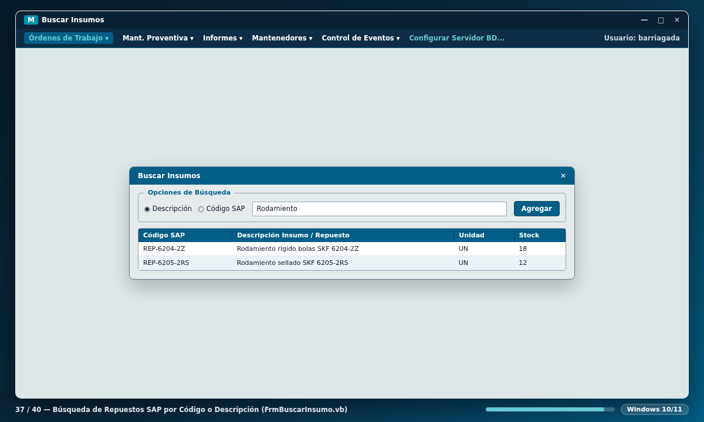](docs/screenshots/37_FrmBuscarInsumo.png) | **38. `FrmBuscarDatosTecnicos`** — Buscar Datos Técnicos<br/>[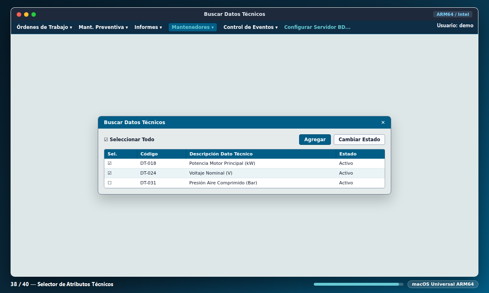](docs/screenshots/38_FrmBuscarDatosTecnicos.png) |
| **39. `FrmBuscarPlanta`** — Buscar Planta<br/>[](docs/screenshots/39_FrmBuscarPlanta.png) | **40. `FrmBuscarSeccion`** — Buscar Sección<br/>[](docs/screenshots/40_FrmBuscarSeccion.png) |

</details>

---

## ⚙️ ¿Qué hace el Sistema? (Módulos Principales)

### 📋 1. Gestión de Órdenes de Trabajo (OT)
* **Registro y Emisión:** Apertura ágil de órdenes correctivas y programadas asociadas a plantas, secciones y máquinas.
* **Control Operativo:** Tipificación de fallas (mecánicas, eléctricas, operacionales), causas raíz y síntomas detectados.
* **Tiempos y Dotación:** Registro exacto de horas de detención de maquinaria, técnicos asignados y horas-hombre invertidas.
* **Insumos y Repuestos:** Detalle de repuestos utilizados con control de costos y proveedores.

### 🛠️ 2. Mantención Preventiva (MP) y Planificación Cíclica
* **Pautas Preventivas:** Configuración de rutinas preventivas por frecuencia en días o por horas acumuladas de operación.
* **Listas de Chequeo Dinámicas:** Checklists diferenciados para tareas mecánicas y eléctricas con tiempos estándar.
* **Carta Gantt Interactiva:** Visualización gráfica temporal de las intervenciones preventivas programadas por línea, equipo y rango de fechas, con exportación directa a Excel y PDF.
* **Planificador de Ciclos:** Despliegue de ciclos futuros con reprogramación automática.

### 🏭 3. Estructura Jerárquica de Activos (Nodos de Planta)
* **Árbol de Equipos:** Navegación arbórea multinivel estructurada en `Empresa > Planta > Sección > Máquina > Módulo > Componente`.
* **Fichas Técnicas:** Catálogo de especificaciones técnicas (potencias, rodamientos, voltajes, presiones y manuales asociados).

### 👥 4. Dotación de Personal y Calendario de Turnos
* **Ficha del Personal:** Administración de técnicos mecánicos, electricistas y supervisores con sus especialidades.
* **Programación de Turnos:** Generación dinámica de calendarios de turnos rotativos para control de dotación disponible en planta.

### 📊 5. Estadísticas, Informes y Exportación (Cero Dependencias)
* **Filtro Obligatorio por Rango de Fechas (`Desde` / `Hasta`):** Todos los módulos de informes (`Informe OT`, `Mantención Preventiva`, `Ciclos por Máquina`, `Carta Gantt`, `Resúmenes Estadísticos` y `Auditoría`) mantienen siempre activos y validados (`Desde <= Hasta`) los selectores de fecha con inicialización automática del mes en curso.
* **Tableros de Control:** Resúmenes estadísticos interactivos de OTs por técnico, por tipo de falla, por turno y por día.
* **Plantillas Excel Corporativas e Impresión Horizontal Completa:** Las **7 plantillas `.xls` oficiales (13 hojas)** (`inf_ot.xls`, `inf_auditoria.xls`, `inf_datos_tecnicos.xls`, `inf_estadistico.xls`, `inf_listado_ciclo_mp.xls`, `inf_MP.xls` e `InfGantt.xls`) y los formatos condicionales aplican íntegramente la paleta corporativa (`#025E87`, `#0191B3`, `#0F2D44`, `#DDE7E8`, `#EAF3F5`, `#0F172A`), con respaldo **XML SpreadsheetML** horizontal (`FitWidth = 1`, `FitHeight = 0`) cuando Excel COM no está instalado.
* **Exportación Autónoma a PDF Horizontal Completo (iTextSharp + Excel COM):** Generación vectorial directa a PDF en todos los módulos (`InfOt.vb`, `Utilitarios.vb`, `OT.vb`) ajustada al **100 % del ancho de página en Horizontal (`792x612 pts`)** sin recortes laterales ni compresión de filas (`FitToPagesWide = 1`, `FitToPagesTall = False`, pesos proporcionales por columna, `SplitLate = False` / `SplitRows = True` y repetición de encabezados), probada con grandes volúmenes (`500` OTs × `15` columnas).

### 🔐 6. Auditoría Integral, Usuarios y Seguridad
* **Trazabilidad en Tiempo Real:** Registro detallado de cada operación (altas, bajas, modificaciones) con usuario, fecha, hora, equipo (PC) y tabla afectada.
* **Gestión Completa de Usuarios, Perfiles y 21 Permisos (`FrmAdminUsuarios`):** Alta, edición, eliminación, asignación de perfiles personalizados y activación granular de **21 permisos** por módulo (`OT`, `MP`, `Informes`, `Mantenedores`, `Auditoría`), con menú **Configurar Servidor BD...** exclusivo para perfil **`Administrador`**.

### ⚡ 7. Asistente de Configuración SQL y Diagnóstico de Errores
* **Configuración Bajo Demanda y desde Menú:** La pantalla **Inicio de Sesión** se mantiene limpia; si ocurre un fallo de conexión SQL, el sistema explica la causa y pregunta automáticamente si desea abrir **Configurar Servidor BD**. También puede ajustarse manualmente una vez dentro desde **Mantenedores > Configurar Servidor BD...**.
* **Mensajes Comprensibles en Español:** Captura automática de excepciones UI/dominio y fallos SQL (p. ej. error 40, red/VPN desconectada, credenciales o permisos), explicando la causa y ofreciendo abrir la configuración SQL en un clic.
* **Registro Persistente para Depuración:** Guarda automáticamente el detalle técnico completo (`errores_yyyyMMdd.log` con depuración a 30 días) en `%LOCALAPPDATA%\SistemaMantencion\logs\`, accesible desde **Mantenedores > Ver Registro de Errores (Logs)...** o desde el botón **Ver Logs**.

---

## 💻 ¿Qué se necesita para ejecutar el Sistema? (Requisitos)

### 🪟 Para Usuarios en Windows:
* **Sistema Operativo:** Windows 10 o Windows 11 (ediciones de 64 bits).
* **Dependencias:** **Ninguna (Zero-Dependency).** La aplicación está publicada en modo **autocontenido y depurado** (.NET 8 Runtime integrado). No requiere instalar .NET, SQL Client, Crystal Reports ni Microsoft Office.
* **Red:** Conexión a la red local de la empresa o VPN corporativa para comunicarse con el servidor SQL Server.

### 🍏 Para Usuarios en macOS:
* **Sistema Operativo:** macOS 15 Sequoia o superior en Apple Silicon (incluyendo **macOS 27 Golden Gate** y **macOS 28+** sin Rosetta 2), y macOS 11+ en equipos Intel.
* **Hardware:** Binario **Universal Nativo (`arm64` + `x86_64`)** compatible con procesadores **Apple Silicon** (M1, M2, M3, M4 — ejecución **100% nativa ARM64 sin Rosetta 2**) y procesadores **Intel**.
* **Entorno de Ejecución:** **Autocontenido (Cero Dependencias)**. Incluye motor nativo ARM64 (`MetalSharp-Wine v7.0` + `.NET 8 win-arm64`) para Apple Silicon sin alertas de apps Intel, y motor Wine Staging 11.21 + `.NET 8 win-x64` para Macs Intel.
* **Instalación:** Se incluye imagen `.dmg` (compresión LZMA) y paquete `.zip` con instalador automático en un clic (`Instalar_en_Mac.command`), que deja en `/Applications` únicamente el motor nativo de su procesador y crea acceso directo en el Escritorio.

### 🗄️ Para el Servidor de Base de Datos:
* **Motor:** Microsoft SQL Server 2008, 2012, 2014, 2016, 2019, 2022 o Azure SQL Database.
* **Base de Datos:** Instancia con la base de datos `mantencion`.
* **Configuración por defecto:**
  * Host / Servidor: `SrvMagicInfo` (o la IP/nombre configurada en tu red).
  * Catálogo: `mantencion`
  * Usuario: `mantencion`
  * Autenticación: SQL Server Authentication o Windows Integrated Security.

### 🛠️ Para Desarrolladores y Compilación:
* **SDK:** Microsoft .NET 8.0 SDK (`8.0.x` o superior).
* **IDE Recomendado:** Visual Studio 2022 (con carga de trabajo *.NET Desktop Development*) o Visual Studio Code en Linux/macOS.
* **Compilación y generación de compilados/instaladores (`0` advertencias, `0` errores):**
  ```bash
  # Compilar solución en Debug y Release (0 advertencias, 0 errores)
  dotnet build mantencion.sln -c Debug
  dotnet build mantencion.sln -c Release

  # Publicar paquetes autocontenidos Windows x64 (130.40 MB depurado) / ARM64 (141.23 MB depurado)
  dotnet publish mantencion/mantencion.vbproj -c Release -r win-x64 --self-contained true -o mantencion/bin/Release/net8-selfcontained-x64
  dotnet publish mantencion/mantencion.vbproj -c Release -r win-arm64 --self-contained true -o mantencion/bin/Release/net8-selfcontained-arm64

  # Empaquetar NuGet (.nupkg)
  dotnet pack mantencion/mantencion.vbproj -c Release -o Instalador
  ```
* **Automatizadores oficiales:**
  * Windows (Inno Setup `LZMA2` ultra): [`automatizadores de instalacion/Compilar_Instalador.ps1`](automatizadores%20de%20instalacion/Compilar_Instalador.ps1)
  * macOS Universal (`.dmg` `ULMO` + `.zip` `-9`, ARM64 sin Rosetta 2 + Intel): [`automatizadores de instalacion/Generar_Instalador_Mac.sh`](automatizadores%20de%20instalacion/Generar_Instalador_Mac.sh)

---

## 📦 Descargas Oficiales e Instaladores (v2026.1 LTS)

> **Nota:** Todos los instaladores y compilaciones (**Debug**, **Release**, **`win-x64`**, **`win-arm64`** y **macOS Universal**) son **100% autocontenidos, compactados y libres de dependencias externas (Zero-Dependency)**, compilados con **`0` errores y `0` advertencias**.

| Plataforma / Compilación | Formato y Descripción del Instalador | Tamaño | Enlace Directo |
| :--- | :--- | :---: | :--- |
| 🪟 **Windows 10 / 11** (`win-x64`) | **`.exe` (Inno Setup `LZMA2`)** — Instalador autocontenido con .NET 8 Desktop, SQL nativo, plantillas `.xls` corporativas, Excel XML e `iTextSharp` PDF horizontal | `41.44 MB` | [⬇️ **Descargar Instalador Windows**](https://github.com/barriagada666-collab/Sistema_gestion_Mantencion/releases/download/v2026.1/Instalador_Sistema_Mantencion_v2026.1.exe) |
| 🍏 **macOS Universal Nativo** (Apple Silicon M1–M4 sin Rosetta 2 + Intel) | **`.dmg` (`ULMO LZMA`)** — Imagen macOS con binario Universal (`arm64` + `x86_64`), motores nativos depurados e instalador en 1 clic (`Instalar_en_Mac.command`) | `289.51 MB` | [⬇️ **Descargar Imagen DMG para Mac**](https://github.com/barriagada666-collab/Sistema_gestion_Mantencion/releases/download/v2026.1/Instalador_Sistema_Mantencion_v2026.1_macOS.dmg) |
| 🍏 **macOS Universal Nativo** (Apple Silicon M1–M4 sin Rosetta 2 + Intel) | **`.zip` (`-9`)** — Paquete portátil con `.app` Universal nativo, script instalador y guía HTML | `365.12 MB` | [⬇️ **Descargar Paquete ZIP para Mac**](https://github.com/barriagada666-collab/Sistema_gestion_Mantencion/releases/download/v2026.1/Instalador_Sistema_Mantencion_v2026.1_macOS_Universal.zip) |
| 📦 **GitHub Packages / NuGet** | **`.nupkg`** — Paquete compilado .NET 8 con documentación, ícono y metadatos del ensamblado | `2.21 MB` | [⬇️ **Descargar Paquete NuGet**](https://github.com/barriagada666-collab/Sistema_gestion_Mantencion/releases/download/v2026.1/Sistema.Gestion.Mantencion.2026.1.0.nupkg) |

<details>
<summary>🔐 Verificación de Integridad (SHA-256 oficial en <code>/Instalador</code>)</summary>

| Archivo | SHA-256 |
| :--- | :--- |
| `Instalador_Sistema_Mantencion_v2026.1.exe` | `FCD9463BC1966967D2FB27E42999FAC9BBFF165DB9218FAB6030ACA3CF9AA5BA` |
| `Instalador_Sistema_Mantencion_v2026.1_macOS.dmg` | `BBA12DCEBBAD28C702124230290C35411297E1461EBA4216287F5DAEE373B500` |
| `Instalador_Sistema_Mantencion_v2026.1_macOS_Universal.zip` | `16995E0DBCE5E31D59525FA59A32198C6CDBA90F0662F1428096B1A301612A3D` |
| `Sistema.Gestion.Mantencion.2026.1.0.nupkg` | `2FED38C630DEDA93BC6AAC92E5B80AF76C8815D5009634403E40DEFCDDCDA125` |

</details>

> 📁 *Todos los binarios, checksums SHA-256 (`checksums_sha256.txt` / `checksums_mac_sha256.txt`) y guía rápida de distribución se sincronizan en [`/Instalador/README.md`](Instalador/README.md).*

---

## 🚀 Guía de Instalación Rápida

### En Windows:
1. Descargue el archivo `Instalador_Sistema_Mantencion_v2026.1.exe`.
2. Ejecute el instalador y siga el asistente estándar.
3. La aplicación creará automáticamente accesos directos en el **Escritorio** y en el **Menú Inicio**.

### En Mac (macOS):
1. Descargue `Instalador_Sistema_Mantencion_v2026.1_macOS.dmg` (o el paquete `.zip`).
2. **Instalación recomendada:** Haga doble clic en `Instalar_en_Mac.command` para instalar en `/Applications`, conservar únicamente el motor nativo de su procesador (Apple Silicon ARM64 o Intel), quitar restricciones de Gatekeeper y crear acceso directo en el Escritorio.
3. También puede arrastrar la aplicación directamente a **Aplicaciones** (ejecuta como **Aplicación Universal** nativa sin Rosetta 2 en Apple Silicon M1–M4 y es compatible con macOS 27 Golden Gate y 28+).

### Conexión a Base de Datos en el Primer Inicio:
1. Al iniciar sesión, si ocurre un fallo de conexión o el servidor SQL de su empresa usa otro nombre o IP distinto a `SrvMagicInfo` (frecuente fuera de la red LAN corporativa o en macOS), el sistema explicará la causa y le ofrecerá abrir automáticamente **Configurar Servidor BD**. Una vez dentro del sistema, el menú **Mantenedores > Configurar Servidor BD...** está restringido exclusivamente a usuarios con perfil **`Administrador`**.
2. Ingrese el Host/IP, Base de Datos y Credenciales.
3. Presione **Probar Conexión** y luego **Guardar y Aplicar** (la aplicación se reiniciará automáticamente cuando cambien los datos de conexión para arrancar con el nuevo servidor/BD).

---

## 📦 Paquete de Desarrollo (GitHub Packages / NuGet)

Para consumir la biblioteca y componentes del sistema en otros proyectos .NET:

```bash
dotnet add package Sistema.Gestion.Mantencion --version 2026.1.0
```

*Registro oficial:* [GitHub Packages - Sistema.Gestion.Mantencion](https://github.com/users/barriagada666-collab/packages/nuget/package/Sistema.Gestion.Mantencion)

---

## 🌟 Novedades de la Versión 2026.1 LTS

* **🎨 Identidad Visual Corporativa Unificada (`Segoe UI` + 7 Plantillas `.xls`):** Paleta corporativa oficial (`#025E87`, `#0191B3`, `#66C9D3`, `#0F2D44`, `#DDE7E8`, `#F2F6F6`) aplicada en los 40 formularios, menú MDI, diseñadores restantes (`FrmAdminAuditoria`, `FrmResumenes`, `Inicio`), árbol de selección de nodos (`Nodo.vb`), formatos dinámicos de informes (`Informes.vb`) y en las **7 plantillas institucionales `.xls` (`13` hojas)** incluyendo formatos condicionales de Carta Gantt.
* **🖨️ Exportación PDF Horizontal Completa para Gran Volumen de OT (`Landscape 100 % Ancho`):** Motores PDF (`InfOt.vb` y `Utilitarios.vb` con `iTextSharp`) y Excel COM (`OT.vb`, `ConfigurarImpresionHorizontalAjustada` y las 7 plantillas `.xls`) estandarizados en orientación **Horizontal Carta (`792x612 pts`)**, ajuste proporcional de columnas al **100 % del ancho** (`FitToPagesWide = 1`), páginas verticales automáticas (`FitToPagesTall = False`), `SplitLate = False` / `SplitRows = True` y títulos repetidos por página (validado con `500` OTs × `15` columnas en `26` páginas y plantilla Excel COM).
* **⚡ Carga Ultrarrápida de Árbol de Activos (1 Consulta) y Formularios:** `Nodo.vb` carga el árbol completo de equipos en una sola consulta SQL y ensamble en memoria (`2.780` nodos en `24 ms`, activos `1.421` nodos en `47 ms` frío / `9 ms` caché en memoria, nodos MP `1.130` en `17 ms`), con `SyncLock`, precalentamiento asíncrono post-login (`Login.vb`), caché de clave primaria en `FrmAdminNodos` y carga optimizada de los **40 formularios** (`14 ms`–`384 ms`).
* **👥 Gestión Completa de Usuarios, Perfiles y Permisos (`FrmAdminUsuarios`, `Usuario.vb`):** CRUD integral de usuarios, administración de perfiles y matriz de **21 permisos** por módulo, más restricción del menú **Mantenedores > Configurar Servidor BD...** al perfil **`Administrador`**.
* **🛡️ Configuración SQL Bajo Demanda e Indicador en Vivo:** Barra inferior con farol verde/rojo del servidor y base de datos activos junto a *Sesión activa*, reinicio automático al cambiar parámetros de conexión y bitácora persistente `%LOCALAPPDATA%\SistemaMantencion\logs\errores_yyyyMMdd.log`.
* **🧩 Iconografía Normalizada (`16x16`) y Fechas Validadas:** Depuración de `.ico` sobredimensionados y validación obligatoria `Desde <= Hasta` en todos los informes.
* **📦 Compilaciones Debug/Release e Instaladores Compactos (CI/CD Node 24):** Debug, Release, `win-x64` (`130.40 MB` depurada), `win-arm64` (`141.23 MB` depurada), `EXE` `LZMA2` (`41.44 MB`), macOS Universal nativo `DMG` (`289.51 MB`, sin Rosetta 2) y `ZIP` (`365.12 MB`) verificados con **`0` advertencias, `0` errores y `0` annotations**.

---

<div align="center">

### Cambiaso Hnos. S.A.C. — División de Mantención Industrial
📍 *Virginia Bravo Letelier 777, Placilla de Peñuelas, Valparaíso, Chile*  
👨‍💻 **Desarrollado y mantenido por Boris Arriagada**

</div>
