

  

# Sistema de Gestión Departamento Mantención
### Cambiaso Hnos. S.A.C. — División de Mantención Industrial
**Plataforma corporativa para Órdenes de Trabajo (OT), Mantención Preventiva (MP), Carta Gantt y Control de Activos**

  &nbsp;
  

---

## 📌 Descripción del Proyecto

El **Sistema de Gestión Departamento Mantención** es una plataforma corporativa de escritorio desarrollada sobre **Microsoft .NET 8 LTS** para planificar, registrar, ejecutar y controlar las operaciones de mantenimiento correctivo y preventivo de activos industriales en **Cambiaso Hnos. S.A.C.**

---

## ⚙️ Características Principales

- **Órdenes de Trabajo (OT):** Creación, edición, asignación técnica, tiempos de detención, control de insumos/repuestos, OT externas y cierre/anulación controlada por permisos.
- **Mantención Preventiva y Carta Gantt:** Pautas periódicas, programación cíclica masiva, selección por casillas de uno o múltiples ciclos (`Solo Marcados`), búsqueda por **N° Mantención (`N° MP`)**, **ID de Ciclo**, máquina, estado o fecha de inicio, ordenamiento por plan más reciente, vista multi-año con barras en color sólido puro y panel inferior de tareas.
- **Activos, Personal y Turnos:** Catálogo jerárquico de plantas, secciones y equipos con carga acelerada en un único recorrido, fichas técnicas por máquina, gestión de dotación y calendario de turnos.
- **Informes y Exportación Integrada:** Selectores inicializados por defecto al rango **ayer – hoy**, reportes individuales y multi-máquina (incluyendo tareas realizadas y pendientes) y exportación coherente a **Excel** y **PDF horizontal completo** sin dependencias externas.
- **Seguridad, Trazabilidad y Versionado:** Control granular de **21 permisos** por perfil, bitácora de auditoría operativa, configuración de conectividad restringida a administradores, menú **Acerca de** con fecha/hora exacta de instalación, indicador permanente de versión en la esquina inferior derecha y versionado centralizado desde `VERSION.txt`.

---

## 🖼️ Capturas del Sistema

  

📸 <strong>Ver las 41 capturas individuales (incluyendo Acerca de)</strong>

 

| Vista (Impar) | Vista (Par) |
| :---: | :---: |
| **01.** Pantalla de Arranque Corporativa  | **02.** Inicio de Sesión Corporativo  |
| **03.** Escritorio Principal MDI [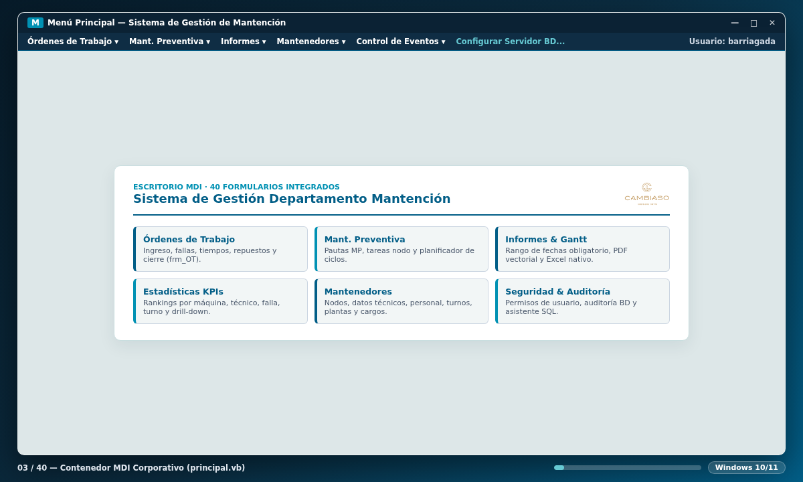](docs/screenshots/03_principal.png) | **04.** Configuración de Servidor BD  |
| **05.** Gestión de Órdenes de Trabajo  | **06.** Detalle Completo de OT  |
| **07.** Gestión de Mantención Preventiva [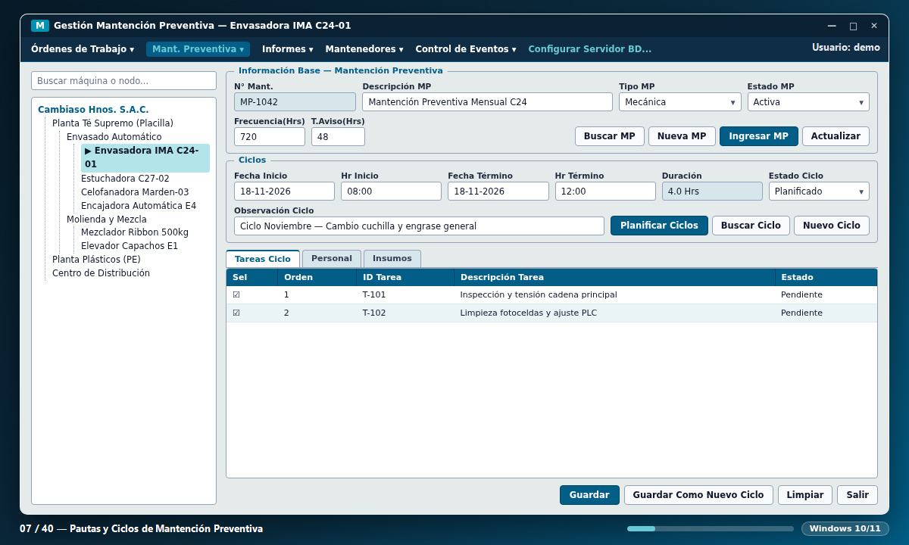](docs/screenshots/07_FrmMp.png) | **08.** Tareas Preventivas por Máquina  |
| **09.** Planificador Masivo de Ciclos  | **10.** Informe de Órdenes de Trabajo [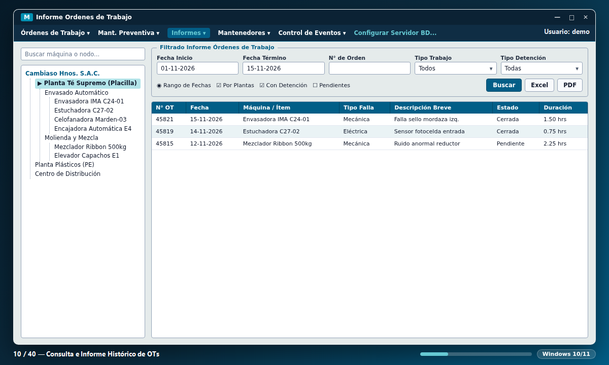](docs/screenshots/10_FrmInfOT.png) |
| **11.** Visor Nativo y Exportación PDF  | **12.** Informe de Mantención Preventiva  |
| **13.** Comparativo de Ciclos Multi-Máquina [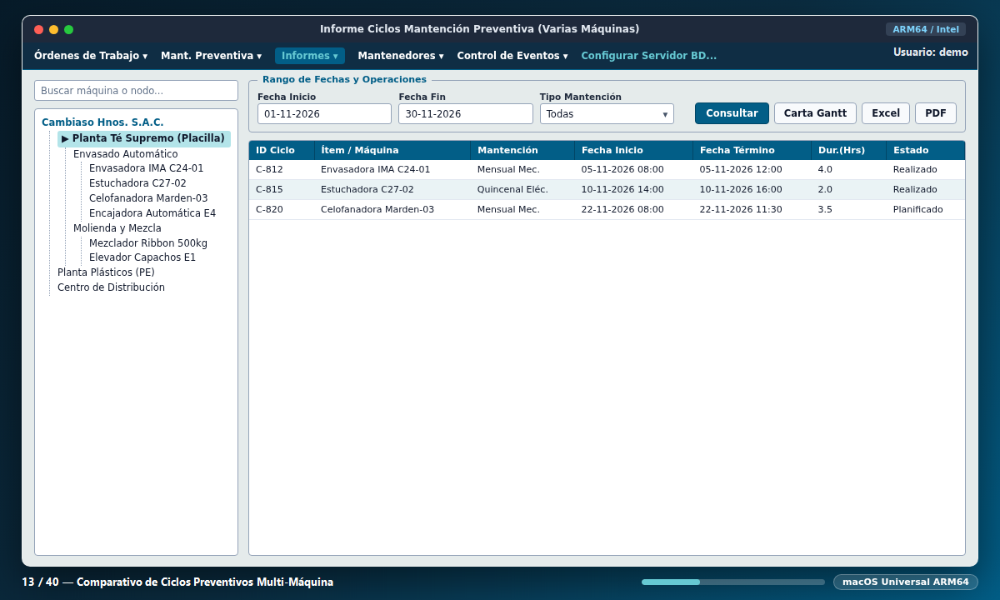](docs/screenshots/13_FrmInfMantPrevCiclosMaq.png) | **14.** Carta Gantt Preventiva  |
| **15.** Resúmenes y KPIs Estadísticos  | **16.** Detalle OT Por Día  |
| **17.** Detalle OT Por Técnico  | **18.** Detalle OT Por Estado [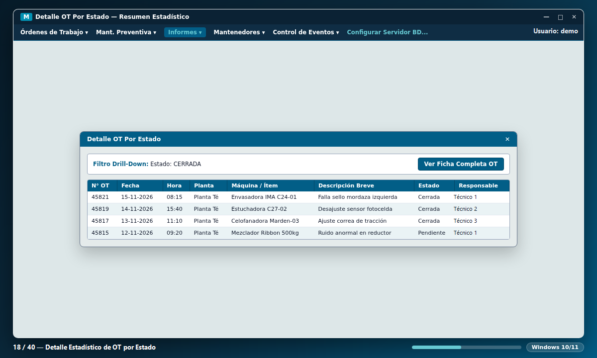](docs/screenshots/18_FrmDetalleOtEstado.png) |
| **19.** Detalle OTs Pendientes [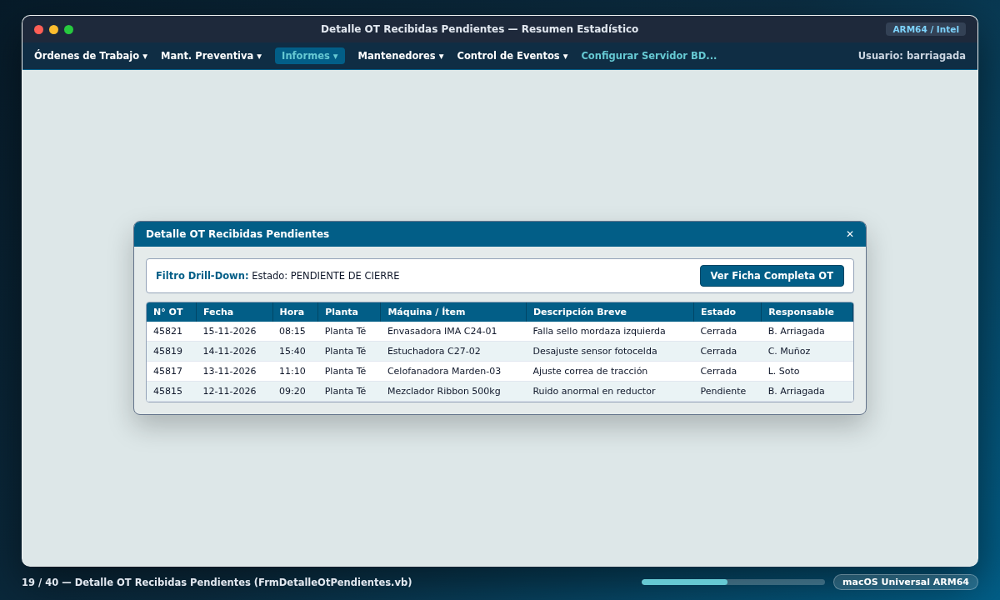](docs/screenshots/19_FrmDetalleOtPendientes.png) | **20.** Detalle OT Por Falla  |
| **21.** Detalle OT Por Turno  | **22.** Estructura Jerárquica de Activos [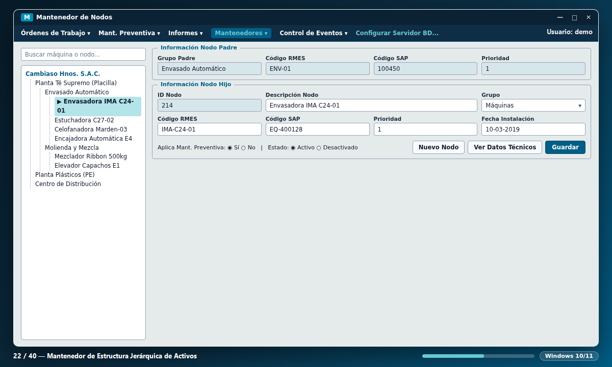](docs/screenshots/22_FrmAdminNodos.png) |
| **23.** Catálogo de Datos Técnicos  | **24.** Fichas Técnicas por Máquina  |
| **25.** Consulta de Ficha Técnica [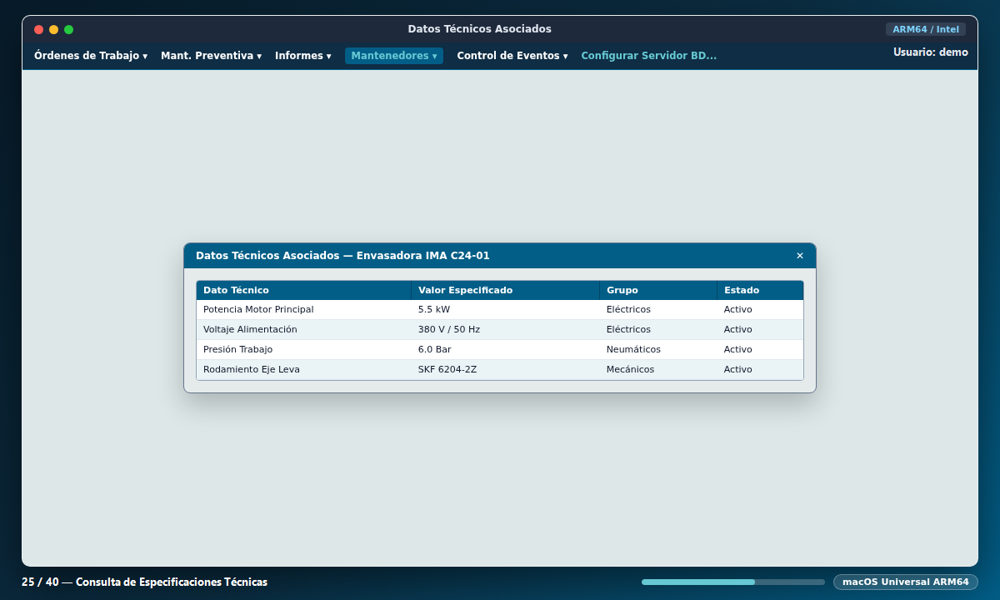](docs/screenshots/25_FrmVerDatosTecnicos.png) | **26.** Gestión de Personal Técnico [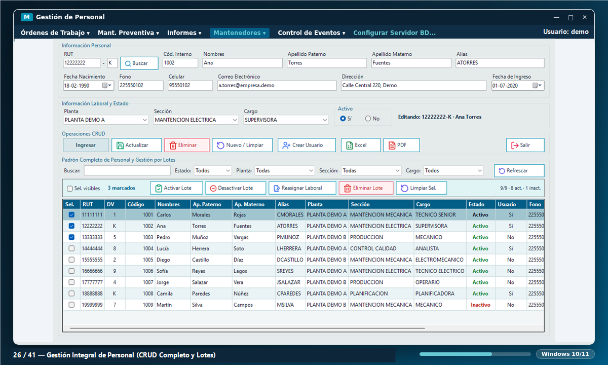](docs/screenshots/26_FrmPersonal.png) |
| **27.** Calendario de Turnos [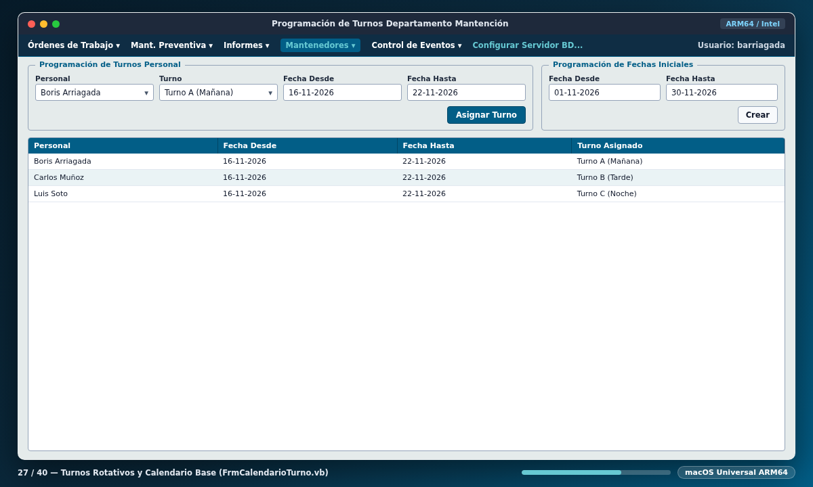](docs/screenshots/27_FrmCalendarioTurno.png) | **28.** Administración de Cargos  |
| **29.** Mantenedor de Plantas  | **30.** Mantenedor de Secciones [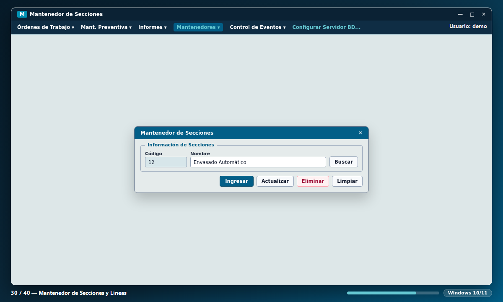](docs/screenshots/30_FrmSeccion.png) |
| **31.** Usuarios, Perfiles y Permisos [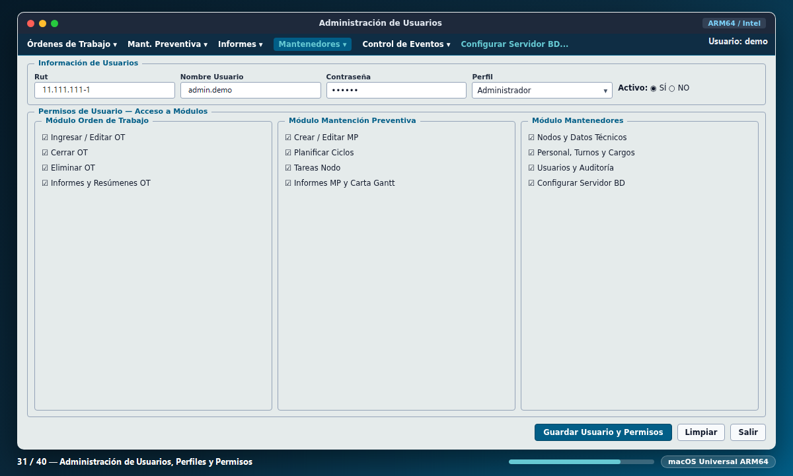](docs/screenshots/31_FrmAdminUsuarios.png) | **32.** Auditoría de Operaciones  |
| **33.** Selector de Mantención Preventiva  | **34.** Selector de Ciclos MP  |
| **35.** Selector de Tareas Preventivas  | **36.** Selector de Personal [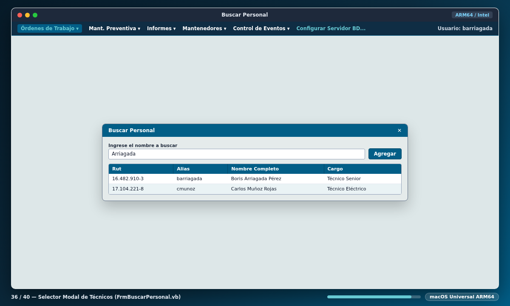](docs/screenshots/36_FrmBuscarPersonal.png) |
| **37.** Búsqueda de Insumos y Repuestos  | **38.** Selector de Datos Técnicos  |
| **39.** Selector de Plantas  | **40.** Selector de Secciones  |
| **41.** Acerca de (Versión y Fecha de Instalación) [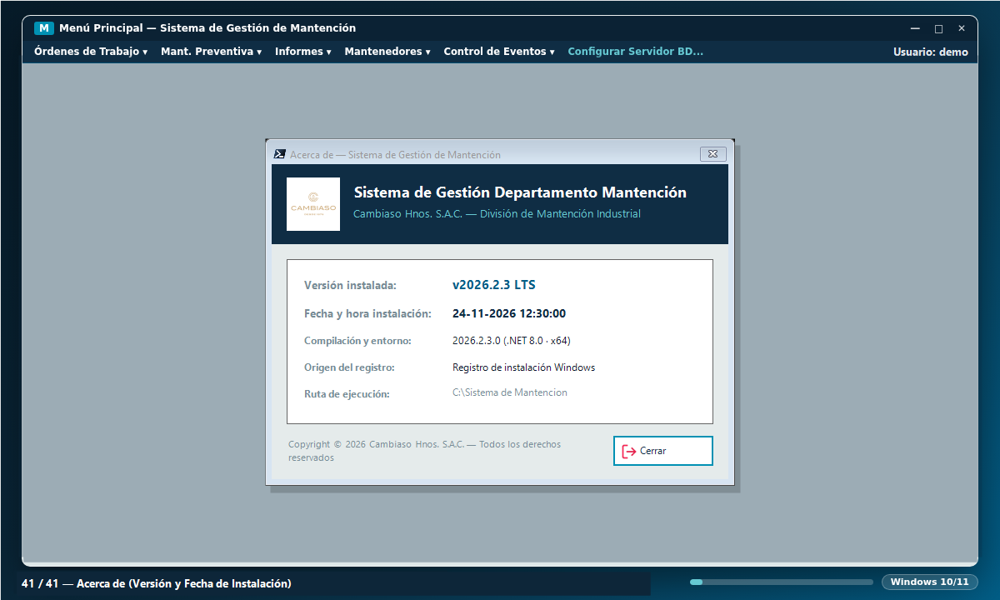](docs/screenshots/41_FrmAcercaDe.png) | — |

---

## 📦 Descargas Oficiales (v2026.2.1 LTS)

> **Autocontenido (Zero-Dependency):** No requiere instalar previamente .NET Runtime, Crystal Reports ni Microsoft Office.

| Plataforma | Instalador | Tamaño | Descarga |
| :--- | :--- | :---: | :--- |
| 🪟 **Windows 10 / 11** (`x64`) | Instalador estándar (`.exe`) | `41.46 MB` | [⬇️ **Descargar Windows (.exe)**](https://github.com/barriagada666-collab/Sistema_gestion_Mantencion/releases/download/v2026.2.1/Instalador_Sistema_Mantencion_v2026.2.1.exe) |
| 🍏 **macOS Universal** (`ARM64` + `Intel`) | Imagen de disco (`.dmg`) | `293.26 MB` | [⬇️ **Descargar macOS (.dmg)**](https://github.com/barriagada666-collab/Sistema_gestion_Mantencion/releases/download/v2026.2.1/Instalador_Sistema_Mantencion_v2026.2.1_macOS.dmg) |
| 🍏 **macOS Universal** (`ARM64` + `Intel`) | Archivo comprimido (`.zip`) | `365.17 MB` | [⬇️ **Descargar macOS (.zip)**](https://github.com/barriagada666-collab/Sistema_gestion_Mantencion/releases/download/v2026.2.1/Instalador_Sistema_Mantencion_v2026.2.1_macOS_Universal.zip) |
| 📦 **NuGet** | Paquete de distribución (`.nupkg`) | `2.23 MB` | [⬇️ **Descargar Paquete (.nupkg)**](https://github.com/barriagada666-collab/Sistema_gestion_Mantencion/releases/download/v2026.2.1/Sistema.Gestion.Mantencion.2026.2.1.nupkg) |

🔐 Verificación de Integridad (SHA-256)

| Archivo | SHA-256 |
| :--- | :--- |
| `Instalador_Sistema_Mantencion_v2026.2.1.exe` | `3460AC839E227C024B9D939512760EA272664B0979E8BCAF8E641225FE79ED2C` |
| `Instalador_Sistema_Mantencion_v2026.2.1_macOS.dmg` | `F25D07531681577FD67B42472A7D5E76029ECD563F44497B9CAE300E29513064` |
| `Instalador_Sistema_Mantencion_v2026.2.1_macOS_Universal.zip` | `042890420F56C3875FC968B3F3899797A910B90B2B8144B5F9BE066FF8B0E9CF` |
| `Sistema.Gestion.Mantencion.2026.2.1.nupkg` | `2BB42980D0110FF95E2F442BFA691426C09DCBE7273D0E627857B3E2A3EB2CE7` |

---

## 💻 Requisitos e Instalación

### Requisitos
- **Windows:** Windows 10 u 11 de 64 bits (`x64` o compatible).
- **macOS:** macOS 11+ con procesador Apple Silicon (`ARM64`) o `Intel` (`x86_64`).
- **Red:** Acceso a la red corporativa para conectarse al servidor de datos de la organización.

### Instalación
- **Windows:** Descargue y ejecute `Instalador_Sistema_Mantencion_v2026.2.1.exe` y siga el asistente en español (soporta instalación silenciosa `/VERYSILENT /SUPPRESSMSGBOXES /NORESTART` y actualización directa conservando la configuración del usuario).
- **macOS:** Monte `Instalador_Sistema_Mantencion_v2026.2.1_macOS.dmg` (o descomprima el `.zip`) y ejecute `Instalar_en_Mac.command`.

---

## 🛠️ Configuración y Uso

1. Inicie sesión con sus credenciales corporativas habilitadas.
2. Navegue por los módulos desde la barra superior (**Órdenes de Trabajo**, **Mant. Preventiva**, **Informes**, **Mantenedores**, **Control de Eventos**, **Acerca de**).
3. En los filtros por fecha de informes, auditoría y turnos, las fechas se inicializan automáticamente entre **ayer y hoy**.
4. En **Carta Gantt**, marque uno o varios ciclos mediante casillas para enfocar o exportar exactamente su selección, o busque por **N° MP**, **ID Ciclo**, texto o **Estado**.
5. La barra inferior muestra el estado de conexión a la izquierda y la versión activa en la esquina inferior derecha (`v2026.2.1`, clic para abrir **Acerca de** con la fecha y hora exacta de instalación). Los usuarios **Administrador** pueden ajustar la conectividad desde **Mantenedores**.

---

## 📚 Documentación Completa

- 🏗️ [Documentación Técnica y Arquitectura](docs/ARQUITECTURA_TECNICA.md)
- 📘 [Manual Funcional del Usuario](docs/MANUAL_FUNCIONAL.md)
- 🛠️ [Guía de Compilación, Versionado y Pruebas](docs/GUIA_COMPILACION.md)
- 🚀 [Guía de Despliegue e Instalación](docs/GUIA_DESPLIEGUE.md)
- 📦 [Paquetes e Instaladores Oficiales](Instalador/README.md)

---

## 🏷️ Versionado e Historial de Cambios

El proyecto sigue el esquema corporativo `YYYY.M.P LTS` (`v2026.2.1 LTS`), gestionado de forma centralizada desde `VERSION.txt`.  
Consulte el historial completo de versiones, mejoras y correcciones en [CHANGELOG.md](CHANGELOG.md).

---

## 👷 Créditos

**Cambiaso Hnos. S.A.C. — División de Mantención Industrial**  
Desarrollado y mantenido por **Boris Arriagada**

