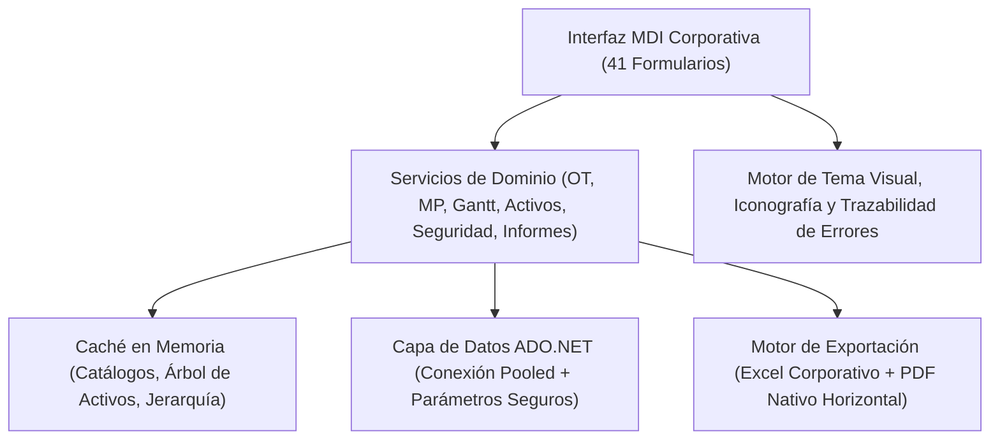

# Arquitectura y Documentación Técnica

**Sistema de Gestión Departamento Mantención** — Cambiaso Hnos. S.A.C. (División de Mantención Industrial)  
**Plataforma:** Microsoft .NET 8 LTS (Windows Desktop WinForms, distribución autocontenida `x64` para Windows 10 y Windows 11).

---

## 1. Visión Arquitectónica

La aplicación está organizada bajo una arquitectura modular de escritorio (MDI) con separación clara entre:

- **Capa de Presentación (`mantencion/forms/`):** 41 formularios corporativos bajo una ventana contenedora MDI principal, con renderizado profesional de menús y barra de estado, soporte DPI escalable (`AutoScaleMode.Dpi`), doble búfer para evitar parpadeos y tema visual unificado.
- **Capa de Servicios y Dominio (`mantencion/class/`):** Clases especializadas por dominio operativo (órdenes de trabajo, mantención preventiva, activos jerárquicos, fichas técnicas, padrón completo y lotes transaccionales de personal, calendario de turnos, plantas, secciones, cargos, usuarios/perfiles/permisos, auditoría, reportes y utilidades transversales).
- **Capa de Datos (ADO.NET Nativo):** Acceso directo a SQL Server corporativo mediante procedimientos almacenados, consultas parametrizadas transaccionales auditadas, pool de conexiones reutilizable y cierre/liberación determinista de recursos en bloques protegidos (`Using` / `Finally`).
- **Motor de Reportes y Exportación:** Generación híbrida mediante plantillas corporativas tipadas (COM Excel sin enlaces tardíos ni advertencias de compilación) y motor nativo integrado (PDF horizontal completo y exportación tabular Excel) que opera sin dependencias externas ni runtimes heredados.

---

## 2. Módulos y Capacidades Técnicas Clave

### 2.1 Rendimiento y Caché Inteligente
- **Carga de Árbol de Activos en un Recorrido:** El árbol jerárquico de plantas, secciones, máquinas y componentes se construye en memoria en una única consulta y se reutiliza mediante caché compartida, evitando viajes recursivos repetidos al servidor.
- **Caché de Catálogos y Autocompletado:** Catálogos operativos (plantas, secciones, cargos, síntomas, modos de falla, personal y jerarquía de resúmenes) se mantienen en memoria y se invalidan automáticamente al editar registros, cerrar sesión o cambiar la configuración de servidor.
- **Optimización de Grillas y Carta Gantt:** Uso de doble búfer, suspensión de diseño durante la carga, validación automática de `FillWeight` para calendarios multi-año (evitando el límite de `65535` de WinForms) y operaciones por bloques en exportaciones extensas.

### 2.2 Seguridad, Perfiles y Control de Accesos
- **Autenticación y Sesión:** Validación de credenciales corporativas y registro de estado de sesión en memoria, limpiado por completo al cerrar sesión.
- **Permisos Granulares (21 permisos):** Control independiente por módulo y por operación crítica (creación, modificación, eliminación y anulación de OT; creación, edición y eliminación de MP/ciclos; mantenedores de activos, personal, ítems, usuarios, tareas y auditoría).
- **Defensa en Profundidad y Control por Módulo:** Validación de perfil **Administrador** y permisos específicos tanto en la navegación como directamente dentro de los eventos críticos de formulario (administración de conectividad SQL, usuarios/perfiles, órdenes de trabajo, mantenciones preventivas, reasignación de tareas y gestión individual o por lotes de personal).
- **Compilación Estricta sin Supresiones:** La solución compila íntegramente en **Debug** y **Release** con **0 errores y 0 advertencias reales** (`NoWarn` de compilación eliminado tras tipar todas las conversiones y accesos COM).
- **Acceso Universal a `Acerca de`:** La consulta de versión instalada y marca temporal de instalación está disponible para todos los perfiles desde el menú superior y desde la barra inferior derecha.

### 2.3 Control Centralizado de Versionado
- El número de versión corporativo (`YYYY.M.P`) se mantiene en una única fuente (`VERSION.txt` en la raíz del repositorio).
- Durante la compilación, el proyecto `.NET` lee automáticamente `VERSION.txt` para poblar `Version`, `AssemblyVersion`, `FileVersion`, `InformationalVersion` y el paquete NuGet.
- Los scripts de empaquetado sincronizan automáticamente la misma versión hacia el instalador Windows, sus gráficas de bienvenida, el paquete NuGet y el flujo CI/CD de GitHub Actions.
- El instalador Windows registra la versión instalada, la carpeta de destino y la fecha/hora exacta de instalación en el Registro del usuario/equipo, consumidos en tiempo de ejecución por **Acerca de** (con respaldo automático a la marca temporal del ejecutable en modo portable).

### 2.4 Diagnóstico y Registro de Errores
- Captura centralizada de excepciones controladas y no controladas en registros diarios locales dentro del perfil del usuario (`%LOCALAPPDATA%\SistemaMantencion\logs\`), incluyendo contexto del módulo, arquitectura, versión de runtime y traza completa sin exponer secretos.
- Acceso rápido para soporte desde el menú de registro de errores cuando se requiere diagnóstico en terreno.
